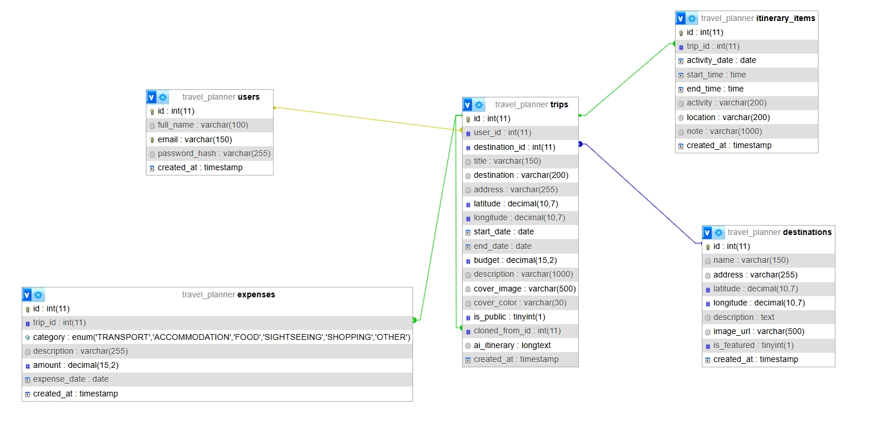

# Cơ sở dữ liệu TravelPlan

> Từ Sprint 1, cấu trúc bảng chính thức nằm ở `Backend/prisma/schema.prisma` (PostgreSQL, tạo bảng bằng `npx prisma migrate dev`, xem README ở gốc repo). File `travel_planner.sql` dưới đây là thiết kế ban đầu cho MySQL/XAMPP, giữ lại để tham khảo; schema Prisma giữ đúng tên bảng và cột của file này, thêm cột `users.role`.

Thư mục này chứa sơ đồ thiết kế cơ sở dữ liệu (ERD) và file khởi tạo SQL cho hệ thống.

## 1. Sơ đồ Thực thể Liên kết (ERD)

## 2. Cấu trúc các bảng chính
1. `users`: Lưu thông tin tài khoản người dùng (họ tên, email, mật khẩu mã hóa).
2. `destinations`: Lưu danh sách các điểm đến nổi bật trên trang chủ và tọa độ bản đồ.
3. `trips`: Lưu thông tin chuyến đi, ngân sách dự kiến, quyền riêng tư (`is_public`), lịch trình gợi ý từ AI (`ai_itinerary`) và ID chuyến gốc khi người dùng bấm "Dùng lại" (`cloned_from_id`).
4. `itinerary_items`: Lưu danh sách các hoạt động chi tiết theo từng ngày và khung giờ của mỗi chuyến đi.
5. `expenses`: Lưu các khoản chi tiêu thực tế theo 6 danh mục (`TRANSPORT`, `ACCOMMODATION`, `FOOD`, `SIGHTSEEING`, `SHOPPING`, `OTHER`).

## 3. Hướng dẫn cài đặt trên XAMPP cho thành viên nhóm
1. Mở XAMPP Control Panel, nhấn Start tại `Apache` và `MySQL`.
2. Truy cập [http://localhost/phpmyadmin](http://localhost/phpmyadmin).
3. Tạo mới một cơ sở dữ liệu có tên là `travel_planner` (hoặc chạy trực tiếp file SQL vì trong file đã có lệnh tạo DB).
4. Chọn tab Import (Nhập) -> Chọn file `travel_planner.sql` trong thư mục này -> Nhấn Go (Thực hiện).
