Trường Đại học Công nghệ Thông tin – ĐHQG TP.HCM

Môn Internet và Công nghệ Web

**Travelplan – Website lên kế hoạch du lịch**

**Đặc tả yêu cầu hệ thống**

*(System Requirement Specification)*

Phiên bản: 1.1

**TP. Hồ Chí Minh, tháng 10/2026**

**Trang phê duyệt**

Chữ ký trên tài liệu này thể hiện sự thống nhất của nhóm về nội dung
"Đặc tả yêu cầu hệ thống Travelplan".

| **Người soạn**   | Họ tên: …………………………… | Chữ ký: ………… | Ngày: …/…/2026 |
|------------------|---------------------|--------------|----------------|
| **Người review** | Họ tên: …………………………… | Chữ ký: ………… | Ngày: …/…/2026 |
| **Người duyệt**  | Họ tên: …………………………… | Chữ ký: ………… | Ngày: …/…/2026 |

**Lịch sử thay đổi**

*\* A – Thêm mới, M – Sửa, D – Xóa*

| **Ngày**   | **Mục thay đổi** | **A\* / M / D** | **Mô tả**                                                                                                                                                                          | **Phiên bản** |
|------------|------------------|-----------------|------------------------------------------------------------------------------------------------------------------------------------------------------------------------------------|---------------|
| 21/10/2026 | Toàn bộ          | A               | Tạo mới theo khung SRS mẫu, dựa trên thiết kế canvas và mã nguồn hiện tại                                                                                                          | 1.0           |
| 21/10/2026 | 1, 5, 6, 7, 8    | M               | Đổi backend từ Java Spring Boot sang Node.js (Express, Prisma); cơ sở dữ liệu local đổi từ SQL Server sang PostgreSQL; cập nhật tích hợp email, chuyển đổi dữ liệu, trạng thái API | 1.1           |

**Mục lục**

1\. Giới thiệu

1.1 Mục đích

Tài liệu đặc tả yêu cầu chức năng này nhằm:

- Xác định phạm vi, các chức năng và nhóm người dùng của website
  Travelplan.

- Mô tả các quy trình nghiệp vụ mà hệ thống phải hỗ trợ: tìm ý tưởng,
  lên lịch trình, theo dõi ngân sách, chia sẻ lịch trình.

- Tạo cách hiểu chung giữa người làm thiết kế, frontend, backend và
  người kiểm thử.

- Làm cơ sở để viết test case nghiệm thu: mỗi use case có luồng hoạt
  động, quy tắc nghiệp vụ và màn hình tương ứng.

1.2 Tổng quan

Travelplan là website giúp nhóm bạn lên kế hoạch chuyến đi trong nước:
chọn điểm đến, xếp hoạt động theo từng ngày, xem thời tiết, ghi khoản
chi và chia sẻ lịch trình cho người khác dùng lại. Hệ thống gồm trang
tĩnh HTML/CSS/JS, REST API Node.js (Express, Prisma) và cơ sở dữ liệu
PostgreSQL. Hệ thống chỉ làm website (giao diện co giãn), không làm ứng
dụng di động.

**Tác nhân và vai trò**

<table>
<colgroup>
<col style="width: 24%" />
<col style="width: 75%" />
</colgroup>
<thead>
<tr class="header">
<th><strong>Tác nhân</strong></th>
<th><strong>Vai trò</strong></th>
</tr>
<tr class="odd">
<th><strong>Khách</strong></th>
<th>
Người chưa đăng nhập.

<ul>
<li>
Xem Trang chủ, Điểm đến, Lịch trình mẫu, thời tiết.
</li>
<li>
Đăng ký, đăng nhập, quên mật khẩu.
</li>
</ul></th>
</tr>
<tr class="header">
<th><strong>Thành viên</strong></th>
<th>
Người đã đăng nhập.

<ul>
<li>
Làm được mọi việc của Khách.
</li>
<li>
Tạo, sửa, xóa chuyến đi của mình; xếp hoạt động; ghi khoản
chi.
</li>
<li>
Dùng lại và lưu lịch trình, chia sẻ công khai lịch trình của
mình.
</li>
</ul></th>
</tr>
<tr class="odd">
<th><strong>Quản trị nội dung</strong></th>
<th>
Thành viên có role ADMIN.

<ul>
<li>
Thêm, sửa, xóa điểm đến, địa điểm nên ghé, chi phí tham
khảo.
</li>
</ul></th>
</tr>
</thead>
<tbody>
</tbody>
</table>

*Bảng 1: Tác nhân và vai trò trong hệ thống*

**Dữ liệu và dịch vụ ở ngoài hệ thống**

- Bản đồ và gợi ý địa chỉ: OpenStreetMap Nominatim.

- Thời tiết: Open-Meteo.

- Gửi email: máy chủ SMTP.

1.3 Đối tượng đọc

- Nhóm frontend: dựng 14 màn hình theo mục 4 và luồng chuyển trang ở mục
  2.2.2.

- Nhóm backend: làm API và quy tắc nghiệp vụ theo mục 3, mô hình dữ liệu
  ở mục 2.1, danh sách API ở Phụ lục 8.4.

- Người kiểm thử: viết test case từ luồng hoạt động và bảng Business
  Rules của từng use case.

- Giảng viên, người đánh giá: nắm phạm vi và chức năng của đồ án.

1.4 Từ viết tắt

| **Từ viết tắt** | **Ý nghĩa**                                    |
|-----------------|------------------------------------------------|
| **UC**          | Use Case – ca sử dụng                          |
| **BR**          | Business Rule – quy tắc nghiệp vụ              |
| **CBR**         | Common Business Rule – quy tắc nghiệp vụ chung |
| **MSG**         | Message – thông báo                            |
| **ET**          | Email Template – mẫu email                     |
| **JWT**         | JSON Web Token – mã đăng nhập                  |
| **API**         | Giao diện lập trình ứng dụng                   |
| **3N2Đ**        | 3 ngày 2 đêm                                   |
| **WMO**         | Mã thời tiết của Tổ chức Khí tượng Thế giới    |

1.5 Tài liệu tham khảo

- Thiết kế giao diện: các màn hình ở mục 4 (Screen 1–14).

- Tài liệu API Open-Meteo (dịch vụ thời tiết).

- Khung tài liệu tham khảo: FA Management – Requirement Specification
  v0.8.6.

2\. Yêu cầu mức cao

Mục này mô tả tổng quan các chức năng và quy trình của hệ thống bằng sơ
đồ: nhóm người dùng, quyền của từng nhóm và trình tự các bước để hoàn
thành một quy trình. Chi tiết từng chức năng nằm ở mục 3.

2.1 Sơ đồ quan hệ thực thể (ERD)

Sơ đồ thể hiện các bảng dữ liệu và quan hệ giữa chúng. Bảng USERS,
TRIPS, ITINERARY_ITEMS, EXPENSES đã có trong mã nguồn; các bảng và cột
còn lại là phần cần thêm.

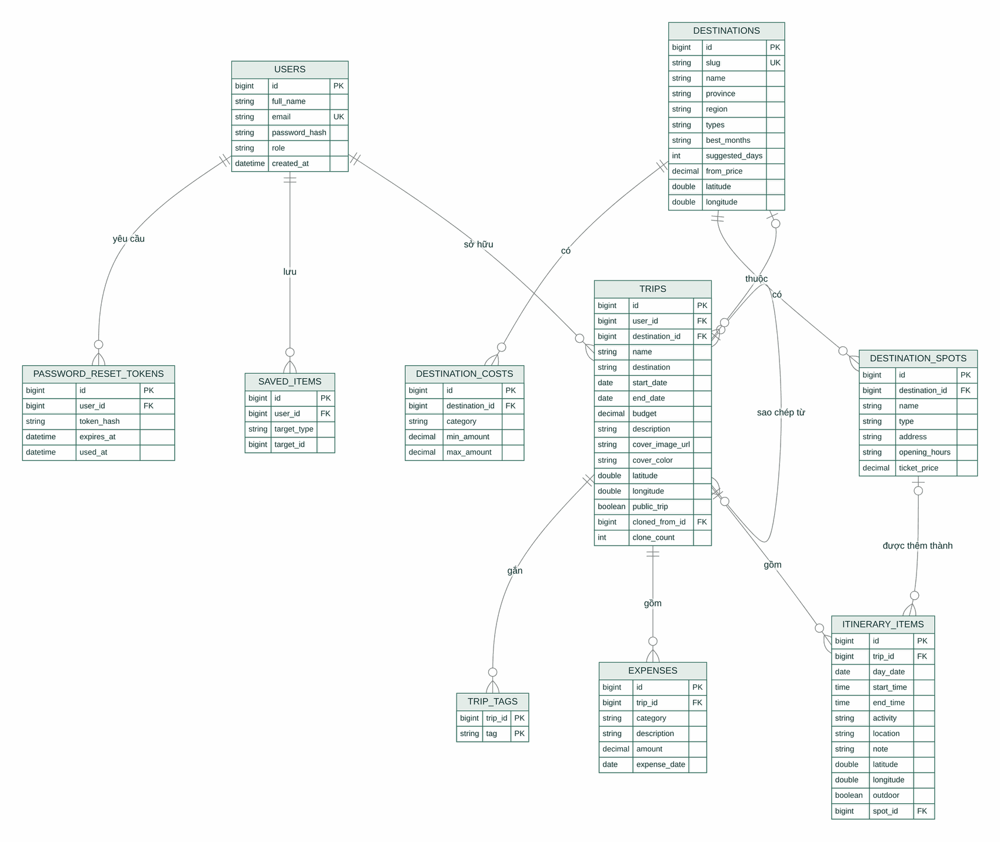

*Hình 1: Sơ đồ quan hệ thực thể của Travelplan*

2.2 Workflow

2.2.1 Quy trình lên kế hoạch một chuyến

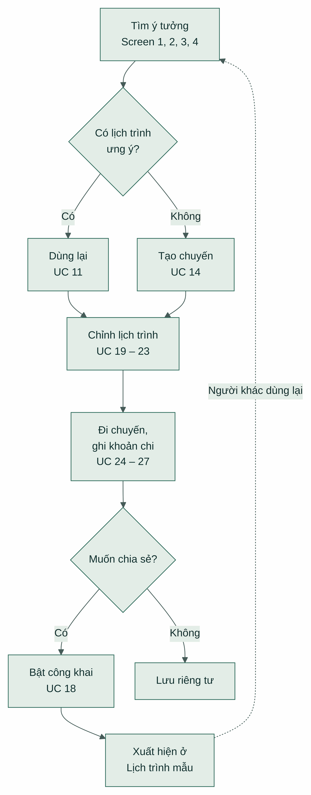

*Hình 2: Quy trình từ tìm ý tưởng tới chia sẻ lịch trình*

2.2.2 Luồng tích hợp giữa các màn hình

Sơ đồ cho thấy cách các màn hình nối với nhau khi tích hợp. Header có ở
mọi trang nên luôn về được Trang chủ, Điểm đến, Lịch trình mẫu, Chuyến
đi của tôi; sơ đồ chỉ vẽ các bước đi từ nội dung trang. Đường nét đứt là
chuyển hướng bắt buộc đăng nhập (CBR 3).

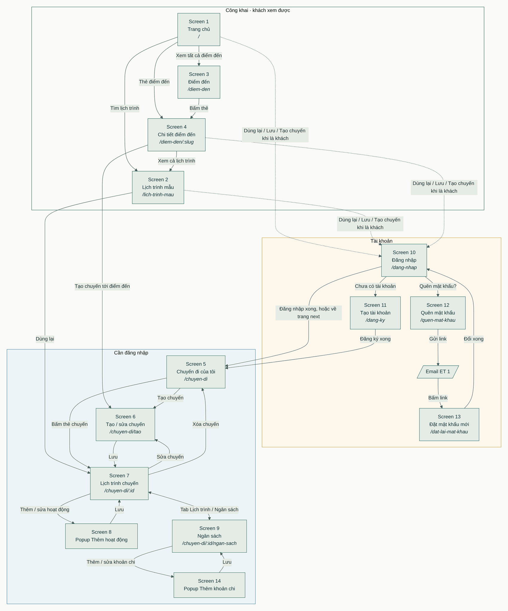

*Hình 3: Luồng tích hợp giữa các màn hình*

**Bảng liên kết giữa các trang**

| **Từ màn hình**     | **Hành động**                               | **Đến màn hình**                            | **Tham số mang theo**                  |
|---------------------|---------------------------------------------|---------------------------------------------|----------------------------------------|
| Screen 1            | Tìm lịch trình                              | Screen 2                                    | ?destination=&start=&days=&budgetMax=  |
| Screen 1            | Bấm thẻ điểm đến                            | Screen 4                                    | slug                                   |
| Screen 1            | Bấm ô "Đi theo kiểu của bạn"                | Screen 2                                    | ?tag=BEACH                             |
| Screen 1, 2, 4      | Dùng lại                                    | Screen 7 (chuyến mới)                       | id chuyến mới từ API clone             |
| Screen 3            | Bấm thẻ                                     | Screen 4                                    | slug                                   |
| Screen 4            | Tạo chuyến tới \<điểm đến\>                 | Screen 6                                    | ?destination=\<slug\>                  |
| Screen 4            | Thêm vào chuyến                             | Screen 8 trên Screen 7                      | tripId, ?day=                          |
| Screen 4            | Xem cả lịch trình                           | Screen 2                                    | ?destination=\<slug\>                  |
| Mọi trang công khai | Thao tác cần đăng nhập khi là khách         | Screen 10                                   | ?next=\<trang hiện tại\>&action=&id=   |
| Screen 10           | Tạo tài khoản / Quên mật khẩu?              | Screen 11 / Screen 12                       | giữ next / email đã gõ                 |
| Email ET 1          | Bấm link                                    | Screen 13                                   | ?token=                                |
| Screen 13           | Lưu mật khẩu                                | Screen 10                                   | MSG 13                                 |
| Screen 10, 11       | Thành công                                  | Trang trong next, nếu không có thì Screen 5 | —                                      |
| Screen 5            | Tạo chuyến / bấm thẻ chuyến                 | Screen 6 / Screen 7                         | tripId                                 |
| Screen 6            | Lưu chuyến đi                               | Screen 7                                    | tripId                                 |
| Screen 7            | Sửa chuyến / Thêm hoạt động / tab Ngân sách | Screen 6 / Screen 8 / Screen 9              | ?edit=tripId / ngày đang chọn / tripId |
| Screen 9            | Thêm khoản chi / bấm khoản chi              | Screen 14                                   | tripId, expenseId                      |

2.3 Sơ đồ chuyển trạng thái

2.3.1 Trạng thái chuyến đi

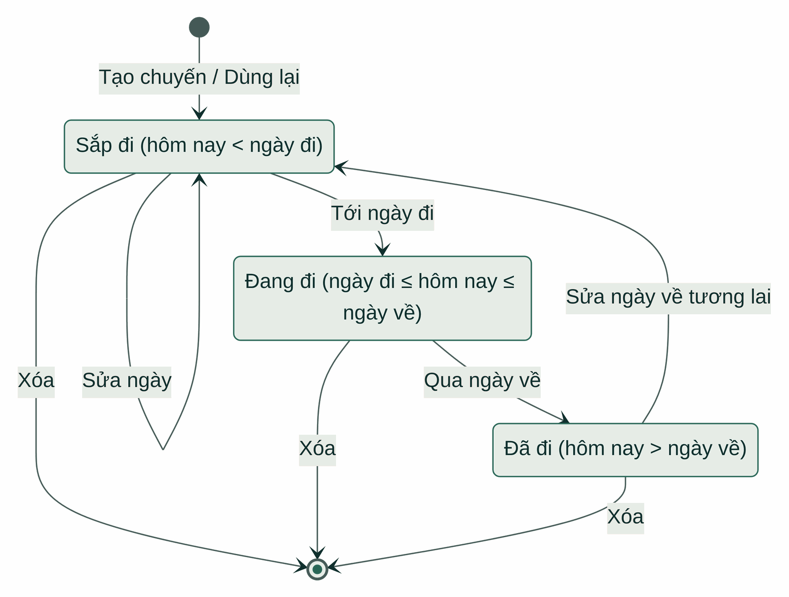

*Hình 4: Trạng thái chuyến đi theo ngày (CBR 4)*

2.3.2 Chế độ chia sẻ

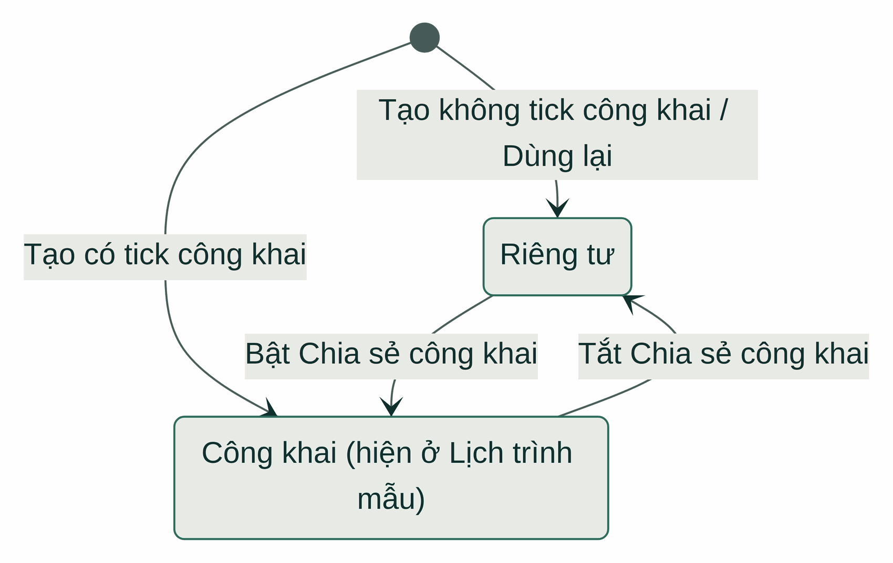

*Hình 5: Chế độ riêng tư / công khai của chuyến*

2.3.3 Trạng thái ngân sách

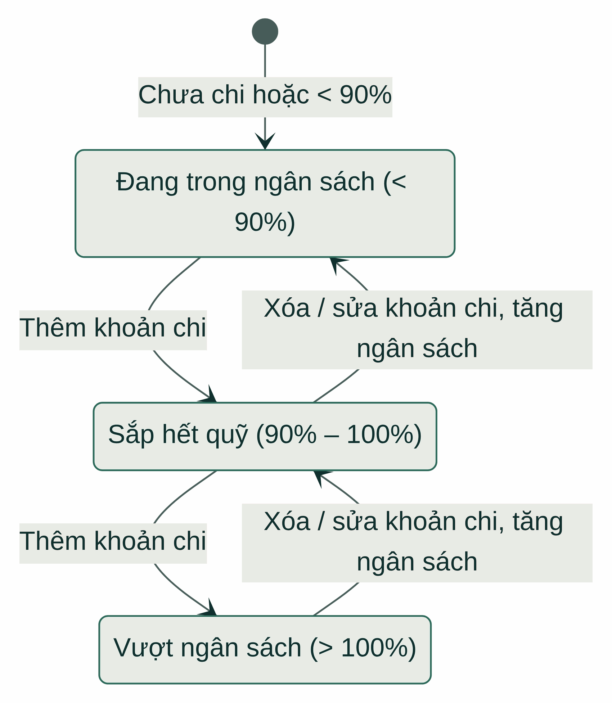

*Hình 6: Trạng thái ngân sách (CBR 6)*

2.3.4 Token đặt lại mật khẩu

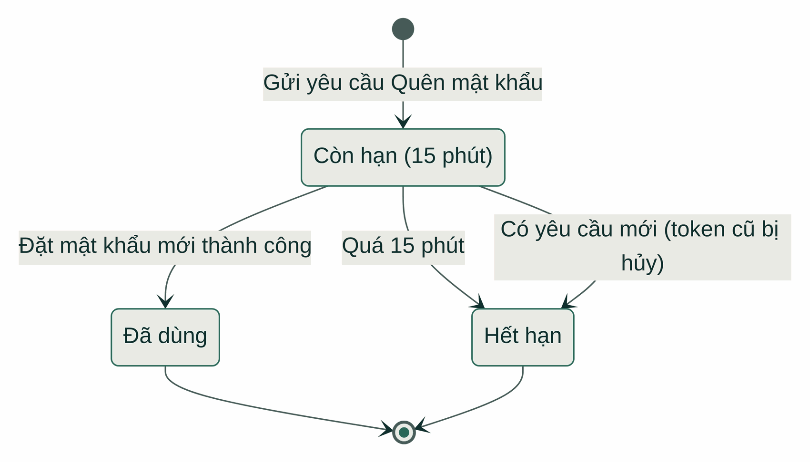

*Hình 7: Vòng đời token đặt lại mật khẩu*

2.4 Sơ đồ use case

Sơ đồ use case cho thấy tác nhân nào dùng chức năng nào. Hình chữ nhật
lớn là ranh giới hệ thống, ô bo góc là use case, ô viền đậm bên trái là
tác nhân.

2.4.1 Chung (Tài khoản)

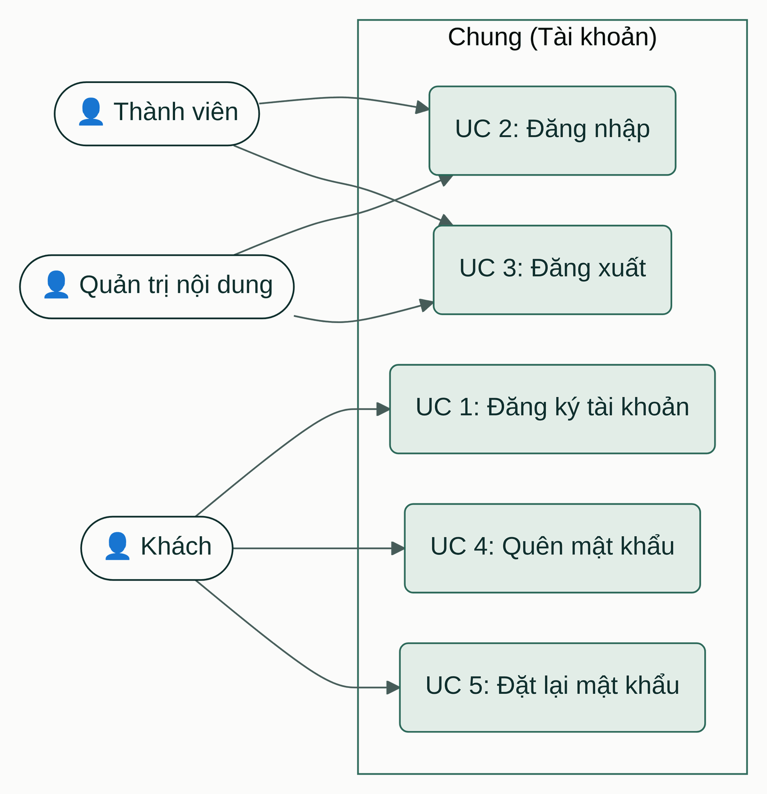

*Hình 8: Sơ đồ use case module Chung (Tài khoản)*

| **\#** | **Tên use case**  | **Mô tả**                                                         |
|--------|-------------------|-------------------------------------------------------------------|
| 1      | Đăng ký tài khoản | Cho phép khách tạo tài khoản mới để lưu chuyến đi của riêng mình. |
| 2      | Đăng nhập         | Cho phép người dùng đăng nhập vào hệ thống.                       |
| 3      | Đăng xuất         | Cho phép người dùng thoát khỏi hệ thống.                          |
| 4      | Quên mật khẩu     | Cho phép người dùng yêu cầu link đặt lại mật khẩu qua email.      |
| 5      | Đặt lại mật khẩu  | Cho phép người dùng đặt mật khẩu mới từ link trong email.         |

2.4.2 Khám phá

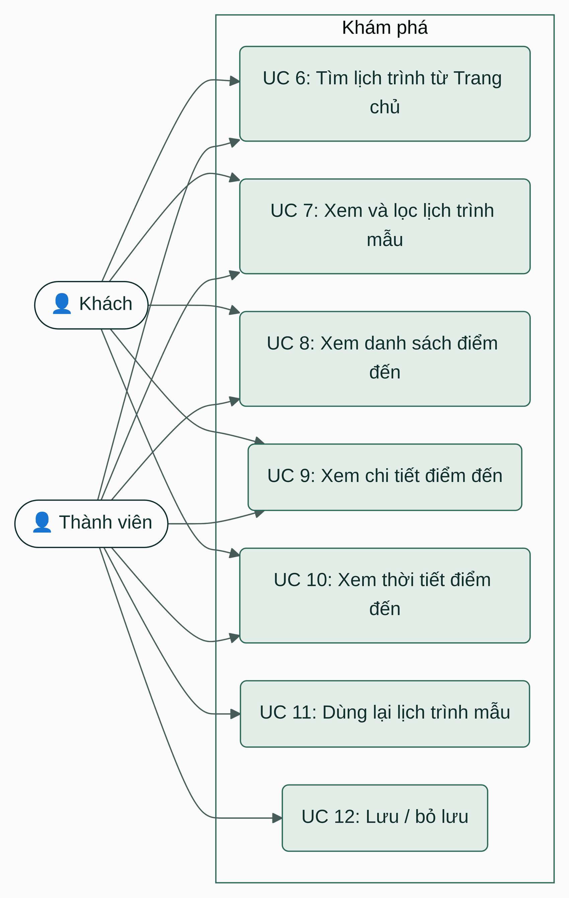

*Hình 9: Sơ đồ use case module Khám phá*

| **\#** | **Tên use case**            | **Mô tả**                                                                                                  |
|--------|-----------------------------|------------------------------------------------------------------------------------------------------------|
| 6      | Tìm lịch trình từ Trang chủ | Cho phép người dùng tìm lịch trình mẫu theo điểm đến, ngày đi, số ngày và ngân sách.                       |
| 7      | Xem và lọc lịch trình mẫu   | Cho phép người dùng duyệt các lịch trình công khai của cộng đồng.                                          |
| 8      | Xem danh sách điểm đến      | Cho phép người dùng xem các điểm đến trong nước theo vùng và theo mùa.                                     |
| 9      | Xem chi tiết điểm đến       | Cho phép người dùng xem thông tin, địa điểm nên ghé, lịch trình mẫu và chi phí tham khảo của một điểm đến. |
| 10     | Xem thời tiết điểm đến      | Cho phép người dùng xem thời tiết hiện tại và dự báo 7 ngày của điểm đến.                                  |
| 11     | Dùng lại lịch trình mẫu     | Cho phép thành viên chép một lịch trình công khai thành chuyến đi của mình.                                |
| 12     | Lưu / bỏ lưu                | Cho phép thành viên lưu lịch trình hoặc điểm đến để xem lại.                                               |

2.4.3 Chuyến đi

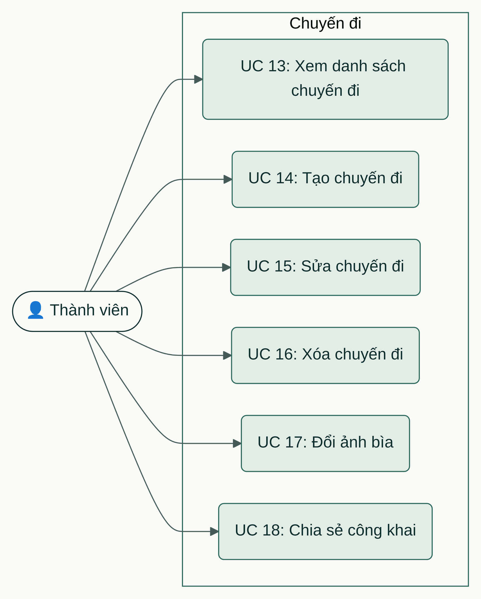

*Hình 10: Sơ đồ use case module Chuyến đi*

| **\#** | **Tên use case**        | **Mô tả**                                                              |
|--------|-------------------------|------------------------------------------------------------------------|
| 13     | Xem danh sách chuyến đi | Cho phép thành viên xem các chuyến của mình.                           |
| 14     | Tạo chuyến đi           | Cho phép thành viên tạo chuyến đi mới.                                 |
| 15     | Sửa chuyến đi           | Cho phép thành viên sửa thông tin chuyến.                              |
| 16     | Xóa chuyến đi           | Cho phép thành viên xóa một chuyến.                                    |
| 17     | Đổi ảnh bìa             | Cho phép thành viên đặt ảnh hoặc màu bìa cho chuyến.                   |
| 18     | Chia sẻ công khai       | Cho phép thành viên bật/tắt công khai lịch trình và chép link chia sẻ. |

2.4.4 Lịch trình

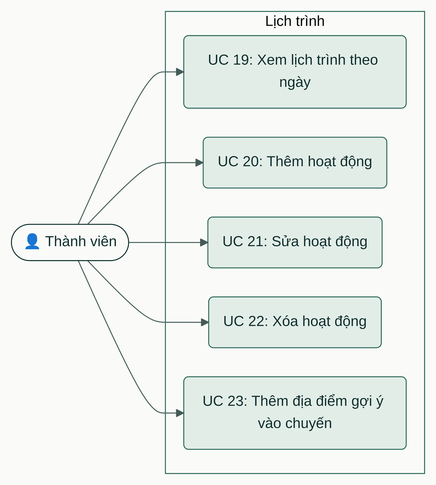

*Hình 11: Sơ đồ use case module Lịch trình*

| **\#** | **Tên use case**               | **Mô tả**                                                             |
|--------|--------------------------------|-----------------------------------------------------------------------|
| 19     | Xem lịch trình theo ngày       | Cho phép thành viên xem hoạt động của từng ngày, thời tiết và bản đồ. |
| 20     | Thêm hoạt động                 | Cho phép thành viên thêm hoạt động vào một ngày.                      |
| 21     | Sửa hoạt động                  | Cho phép thành viên sửa hoạt động.                                    |
| 22     | Xóa hoạt động                  | Cho phép thành viên xóa hoạt động.                                    |
| 23     | Thêm địa điểm gợi ý vào chuyến | Cho phép thành viên thêm một địa điểm nên ghé thành hoạt động.        |

2.4.5 Ngân sách

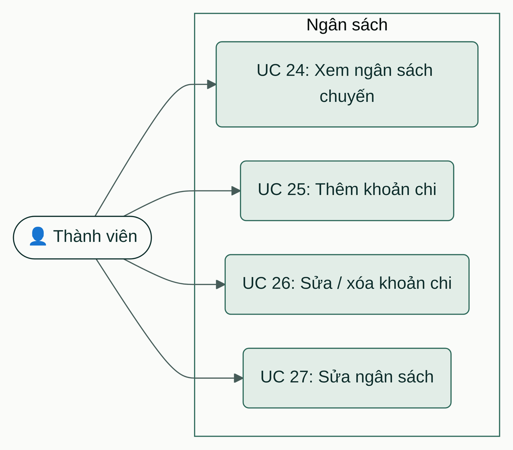

*Hình 12: Sơ đồ use case module Ngân sách*

| **\#** | **Tên use case**     | **Mô tả**                                                     |
|--------|----------------------|---------------------------------------------------------------|
| 24     | Xem ngân sách chuyến | Cho phép thành viên theo dõi số tiền đã chi so với ngân sách. |
| 25     | Thêm khoản chi       | Cho phép thành viên ghi một khoản chi.                        |
| 26     | Sửa / xóa khoản chi  | Cho phép thành viên sửa hoặc xóa khoản chi.                   |
| 27     | Sửa ngân sách        | Cho phép thành viên đổi ngân sách dự kiến.                    |

2.4.6 Quản trị nội dung

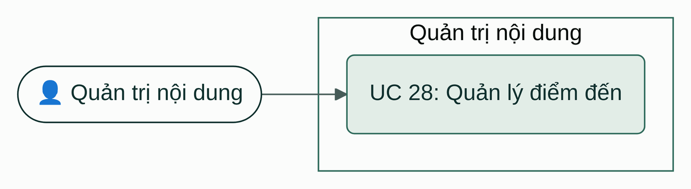

*Hình 13: Sơ đồ use case module Quản trị nội dung*

| **\#** | **Tên use case** | **Mô tả**                                                                         |
|--------|------------------|-----------------------------------------------------------------------------------|
| 28     | Quản lý điểm đến | Cho phép quản trị thêm, sửa, xóa điểm đến, địa điểm nên ghé và chi phí tham khảo. |

2.5 Ma trận phân quyền

Ma trận phân quyền ánh xạ chức năng với vai trò người dùng:

| **X**   | Người dùng được dùng chức năng này với mọi bản ghi được phép xem.  |
|---------|--------------------------------------------------------------------|
| **X\*** | Người dùng chỉ được dùng chức năng này với bản ghi của chính mình. |

| **Chức năng**                         | **Khách** | **Thành viên** | **Quản trị nội dung** |
|---------------------------------------|-----------|----------------|-----------------------|
| **Module: Chung (Tài khoản)**         |           |                |                       |
| UC 1: Đăng ký tài khoản               | X         |                |                       |
| UC 2: Đăng nhập                       |           | X              | X                     |
| UC 3: Đăng xuất                       |           | X              | X                     |
| UC 4: Quên mật khẩu                   | X         |                |                       |
| UC 5: Đặt lại mật khẩu                | X         |                |                       |
| **Module: Khám phá**                  |           |                |                       |
| UC 6: Tìm lịch trình từ Trang chủ     | X         | X              | X                     |
| UC 7: Xem và lọc lịch trình mẫu       | X         | X              | X                     |
| UC 8: Xem danh sách điểm đến          | X         | X              | X                     |
| UC 9: Xem chi tiết điểm đến           | X         | X              | X                     |
| UC 10: Xem thời tiết điểm đến         | X         | X              | X                     |
| UC 11: Dùng lại lịch trình mẫu        |           | X              | X                     |
| UC 12: Lưu / bỏ lưu                   |           | X              | X                     |
| **Module: Chuyến đi**                 |           |                |                       |
| UC 13: Xem danh sách chuyến đi        |           | X\*            | X\*                   |
| UC 14: Tạo chuyến đi                  |           | X\*            | X\*                   |
| UC 15: Sửa chuyến đi                  |           | X\*            | X\*                   |
| UC 16: Xóa chuyến đi                  |           | X\*            | X\*                   |
| UC 17: Đổi ảnh bìa                    |           | X\*            | X\*                   |
| UC 18: Chia sẻ công khai              |           | X\*            | X\*                   |
| **Module: Lịch trình**                |           |                |                       |
| UC 19: Xem lịch trình theo ngày       |           | X\*            | X\*                   |
| UC 20: Thêm hoạt động                 |           | X\*            | X\*                   |
| UC 21: Sửa hoạt động                  |           | X\*            | X\*                   |
| UC 22: Xóa hoạt động                  |           | X\*            | X\*                   |
| UC 23: Thêm địa điểm gợi ý vào chuyến |           | X\*            | X\*                   |
| **Module: Ngân sách**                 |           |                |                       |
| UC 24: Xem ngân sách chuyến           |           | X\*            | X\*                   |
| UC 25: Thêm khoản chi                 |           | X\*            | X\*                   |
| UC 26: Sửa / xóa khoản chi            |           | X\*            | X\*                   |
| UC 27: Sửa ngân sách                  |           | X\*            | X\*                   |
| **Module: Quản trị nội dung**         |           |                |                       |
| UC 28: Quản lý điểm đến               |           |                | X                     |

3\. Đặc tả use case

Mục này mô tả các yêu cầu chức năng: hệ thống phải làm gì với dữ liệu
nhập, hành vi và kết quả mong đợi. Mỗi use case có bảng thông tin, sơ đồ
luồng hoạt động (cột Người dùng và Hệ thống, mỗi bước đánh số) và bảng
quy tắc nghiệp vụ tham chiếu theo số bước.

3.1 Chung (Tài khoản)

UC 1: Đăng ký tài khoản

| **Mục tiêu:**            | Cho phép khách tạo tài khoản mới để lưu chuyến đi của riêng mình.                   |
|--------------------------|-------------------------------------------------------------------------------------|
| **Tác nhân:**            | Khách                                                                               |
| **Điều kiện kích hoạt:** | Khách bấm "Đăng ký miễn phí" trên header hoặc "Tạo tài khoản" ở màn hình Đăng nhập. |
| **Tiền điều kiện:**      | Khách chưa đăng nhập.                                                               |
| **Hậu điều kiện:**       | Tài khoản được tạo, người dùng ở trạng thái đã đăng nhập.                           |

**Màn hình thiết kế**

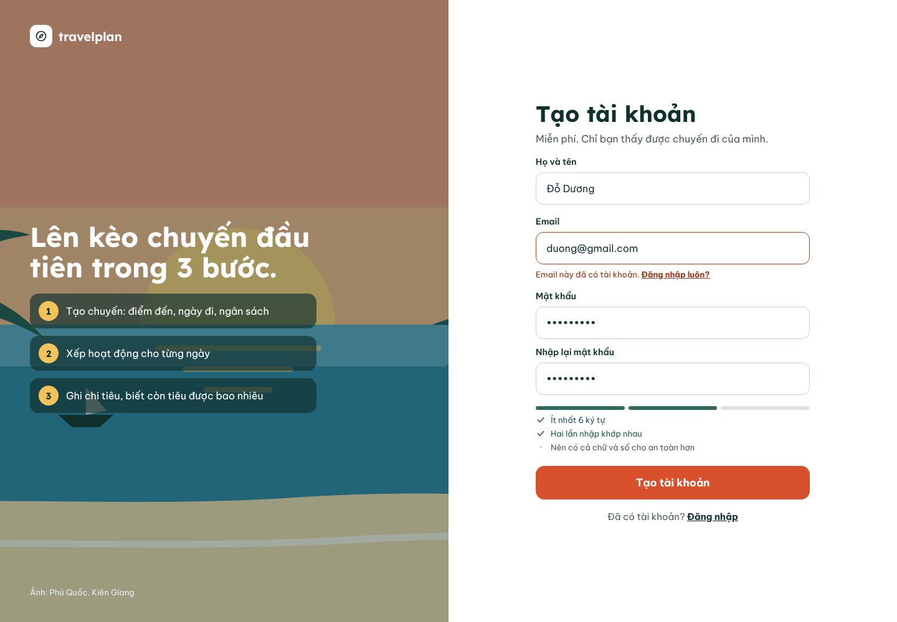

*Screen 11: Tạo tài khoản*

**Luồng hoạt động**

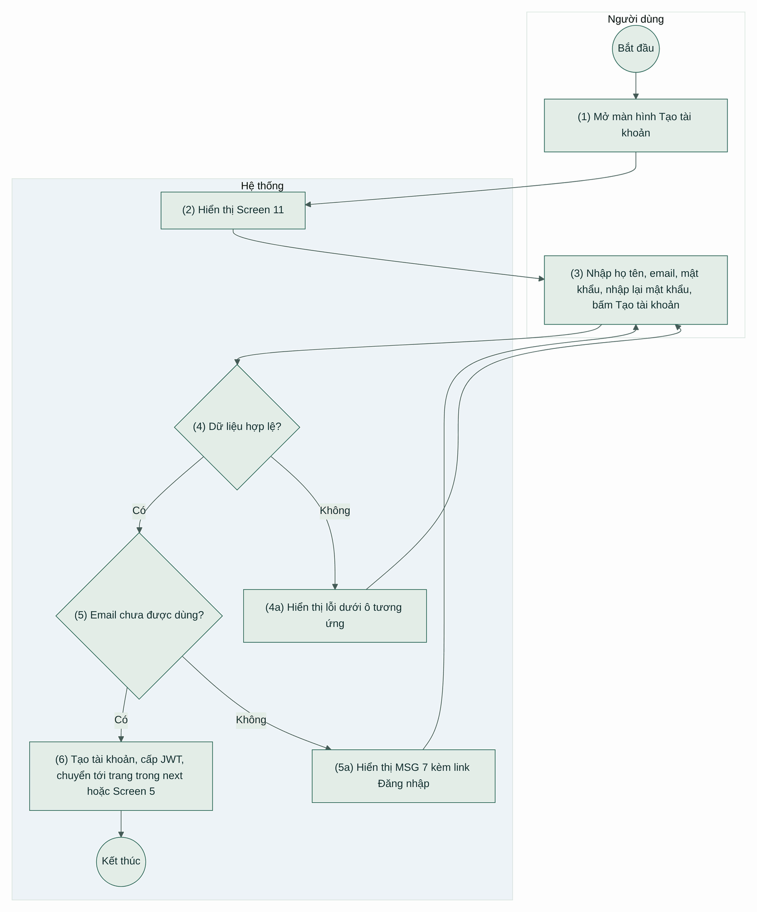

*Hình 14: Luồng hoạt động UC 1: Đăng ký tài khoản*

**Quy tắc nghiệp vụ**

<table>
<colgroup>
<col style="width: 9%" />
<col style="width: 11%" />
<col style="width: 79%" />
</colgroup>
<thead>
<tr class="header">
<th><strong>Bước</strong></th>
<th><strong>Mã BR</strong></th>
<th><strong>Mô tả</strong></th>
</tr>
<tr class="odd">
<th>(2)</th>
<th>BR 1</th>
<th>
<strong><u>Quy tắc hiển thị:</u></strong>

Hệ thống hiển thị Screen 11: Tạo tài khoản. Nếu người dùng đã đăng
nhập, hệ thống chuyển thẳng tới Screen 5.
</th>
</tr>
<tr class="header">
<th>(4)</th>
<th>BR 2</th>
<th>
<strong><u>Quy tắc kiểm tra:</u></strong>

Hệ thống kiểm tra theo CBR 1 và:

<ul>
<li>
[Họ và tên] bắt buộc, tối đa 100 ký tự.
</li>
<li>
[Email] bắt buộc, đúng định dạng, tối đa 150 ký tự (MSG
3).
</li>
<li>
[Mật khẩu] dài 6–100 ký tự (MSG 4).
</li>
<li>
[Nhập lại mật khẩu] phải trùng [Mật khẩu] (MSG 5).
</li>
<li>
Thanh độ mạnh mật khẩu chỉ gợi ý, không chặn việc tạo tài
khoản.
</li>
</ul></th>
</tr>
<tr class="odd">
<th>(5)</th>
<th>BR 3</th>
<th>
<strong><u>Quy tắc trùng dữ liệu:</u></strong>

Hệ thống so [Email] (không phân biệt hoa thường) với email trong bảng
users. Trùng → MSG 7.
</th>
</tr>
<tr class="header">
<th>(6)</th>
<th>BR 4</th>
<th>
<strong><u>Quy tắc tạo mới:</u></strong>

Hệ thống:

<ul>
<li>
Mã hóa mật khẩu bằng BCrypt rồi lưu user với [Ngày tạo] =
&lt;&lt;Ngày giờ hiện tại&gt;&gt;.
</li>
<li>
Cấp JWT hạn 24 giờ và lưu ở localStorage.
</li>
<li>
Hiển thị MSG 20.
</li>
<li>
Chuyển tới trang trong tham số next (nếu là đường dẫn nội bộ),
nếu không có thì tới Screen 5.
</li>
</ul></th>
</tr>
</thead>
<tbody>
</tbody>
</table>

UC 2: Đăng nhập

| **Mục tiêu:**            | Cho phép người dùng đăng nhập vào hệ thống.                                                |
|--------------------------|--------------------------------------------------------------------------------------------|
| **Tác nhân:**            | Thành viên, Quản trị nội dung                                                              |
| **Điều kiện kích hoạt:** | Người dùng bấm "Đăng nhập" trên header, hoặc bị chuyển tới khi làm thao tác cần đăng nhập. |
| **Tiền điều kiện:**      | Người dùng chưa đăng nhập.                                                                 |
| **Hậu điều kiện:**       | Người dùng đăng nhập thành công.                                                           |

**Màn hình thiết kế**

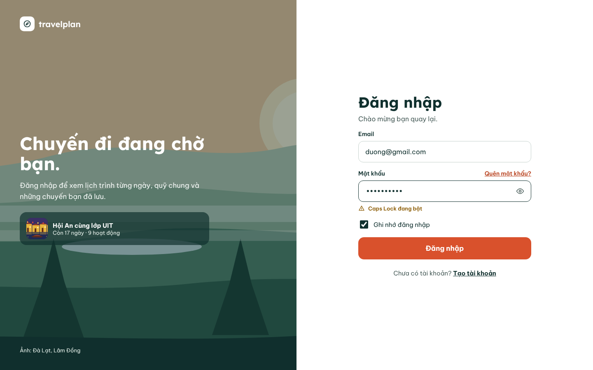

*Screen 10: Đăng nhập*

**Luồng hoạt động**

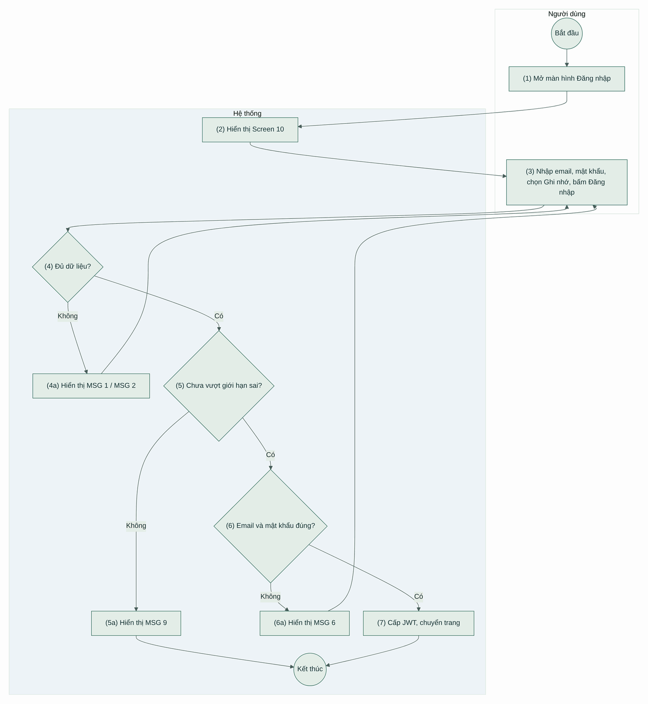

*Hình 15: Luồng hoạt động UC 2: Đăng nhập*

**Quy tắc nghiệp vụ**

<table>
<colgroup>
<col style="width: 9%" />
<col style="width: 11%" />
<col style="width: 79%" />
</colgroup>
<thead>
<tr class="header">
<th><strong>Bước</strong></th>
<th><strong>Mã BR</strong></th>
<th><strong>Mô tả</strong></th>
</tr>
<tr class="odd">
<th>(2)</th>
<th>BR 5</th>
<th>
<strong><u>Quy tắc hiển thị:</u></strong>

Hệ thống hiển thị Screen 10: Đăng nhập. Khi bật Caps Lock trong ô mật
khẩu, hiển thị cảnh báo "Caps Lock đang bật".
</th>
</tr>
<tr class="header">
<th>(4)</th>
<th>BR 6</th>
<th>
<strong><u>Quy tắc kiểm tra:</u></strong>

[Email] trống → MSG 1. [Mật khẩu] trống → MSG 2.
</th>
</tr>
<tr class="odd">
<th>(5)</th>
<th>BR 7</th>
<th>
<strong><u>Quy tắc giới hạn:</u></strong>

Tối đa 10 lần đăng nhập sai trên một IP trong 15 phút. Vượt → MSG
9.
</th>
</tr>
<tr class="header">
<th>(6)</th>
<th>BR 8</th>
<th>
<strong><u>Quy tắc xác thực:</u></strong>

So [Email] và mật khẩu đã băm với bảng users. Không khớp → MSG 6
(không cho biết sai email hay sai mật khẩu).
</th>
</tr>
<tr class="odd">
<th>(7)</th>
<th>BR 9</th>
<th>
<strong><u>Quy tắc đăng nhập:</u></strong>

Hệ thống:

<ul>
<li>
Cấp JWT hạn 24 giờ.
</li>
<li>
Có tick [Ghi nhớ đăng nhập] → lưu token ở localStorage; không
tick → sessionStorage.
</li>
<li>
Gọi /api/auth/me để lấy tên hiển thị trên header.
</li>
<li>
Chuyển tới trang trong next, nếu không có thì Screen 5.
</li>
</ul></th>
</tr>
</thead>
<tbody>
</tbody>
</table>

UC 3: Đăng xuất

| **Mục tiêu:**            | Cho phép người dùng thoát khỏi hệ thống.                   |
|--------------------------|------------------------------------------------------------|
| **Tác nhân:**            | Thành viên, Quản trị nội dung                              |
| **Điều kiện kích hoạt:** | Người dùng chọn "Đăng xuất" trong menu tài khoản (avatar). |
| **Tiền điều kiện:**      | Người dùng đã đăng nhập.                                   |
| **Hậu điều kiện:**       | Người dùng đã đăng xuất.                                   |

**Màn hình thiết kế**

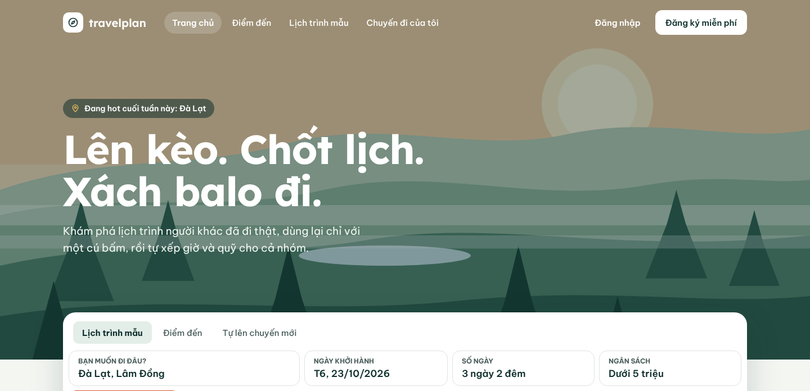

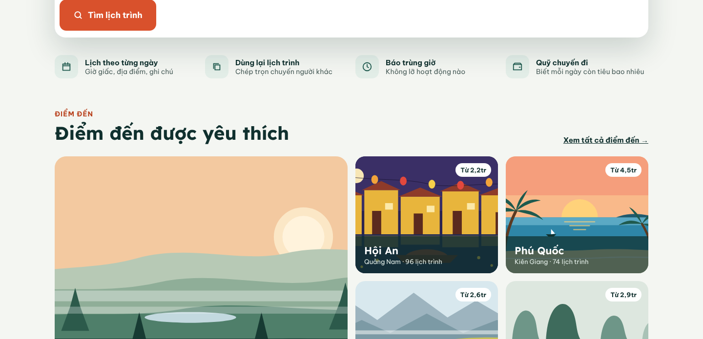

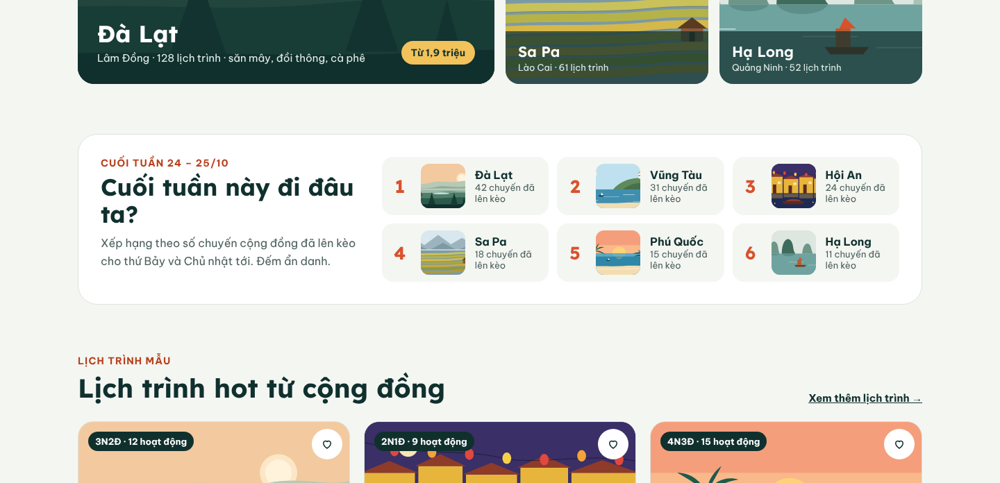

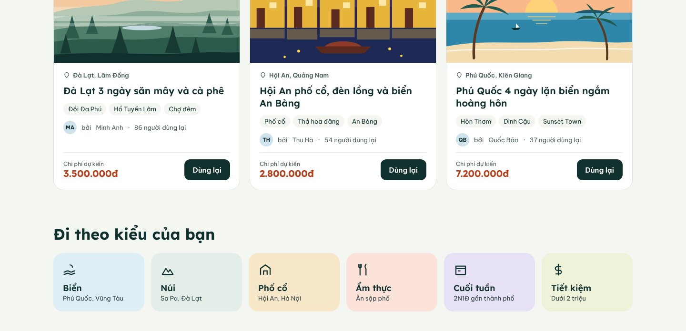

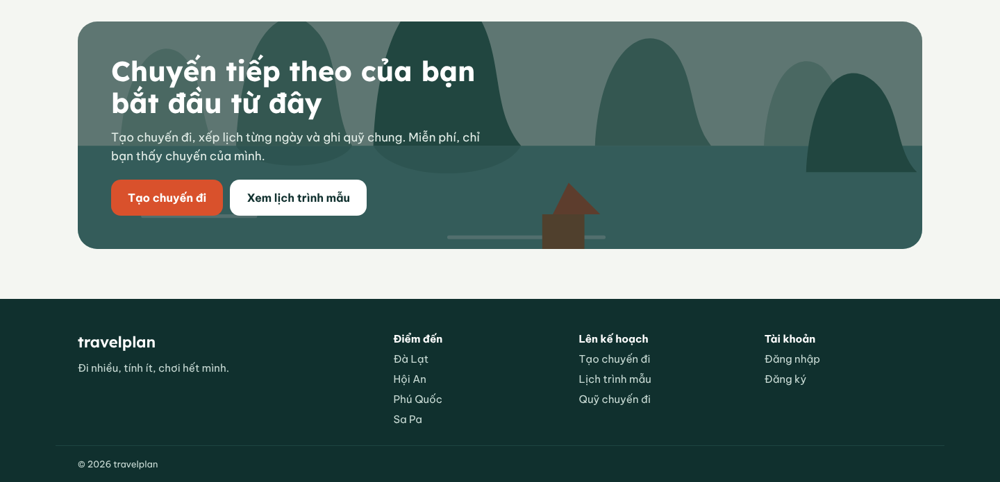

*Screen 1: Trang chủ (5 phần ghép dọc)*

**Luồng hoạt động**

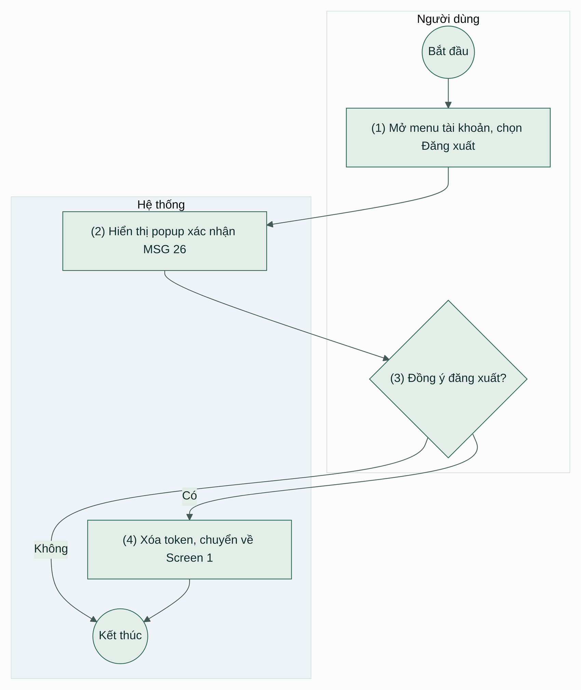

*Hình 16: Luồng hoạt động UC 3: Đăng xuất*

**Quy tắc nghiệp vụ**

<table>
<colgroup>
<col style="width: 9%" />
<col style="width: 11%" />
<col style="width: 79%" />
</colgroup>
<thead>
<tr class="header">
<th><strong>Bước</strong></th>
<th><strong>Mã BR</strong></th>
<th><strong>Mô tả</strong></th>
</tr>
<tr class="odd">
<th>(2)</th>
<th>BR 10</th>
<th>
<strong><u>Quy tắc hiển thị popup:</u></strong>

Hệ thống hiển thị popup xác nhận MSG 26 với hai nút [Hủy] và [Đăng
xuất].
</th>
</tr>
<tr class="header">
<th>(4)</th>
<th>BR 11</th>
<th>
<strong><u>Quy tắc đăng xuất:</u></strong>

Hệ thống xóa token ở localStorage và sessionStorage, chuyển về Screen
1: Trang chủ ở chế độ khách. Không cần gọi server vì JWT không lưu phía
server.
</th>
</tr>
<tr class="odd">
<th>(—)</th>
<th>BR 12</th>
<th>
<strong><u>Quy tắc hết phiên:</u></strong>

Khi bất kỳ API nào trả 401, hệ thống xóa token, hiển thị popup MSG
10, bấm OK thì chuyển tới Screen 10 kèm next là trang đang mở.
</th>
</tr>
</thead>
<tbody>
</tbody>
</table>

UC 4: Quên mật khẩu

| **Mục tiêu:**            | Cho phép người dùng yêu cầu link đặt lại mật khẩu qua email.           |
|--------------------------|------------------------------------------------------------------------|
| **Tác nhân:**            | Khách                                                                  |
| **Điều kiện kích hoạt:** | Người dùng bấm "Quên mật khẩu?" trên Screen 10.                        |
| **Tiền điều kiện:**      | Người dùng chưa đăng nhập.                                             |
| **Hậu điều kiện:**       | Email chứa link đặt lại mật khẩu được gửi nếu email có trong hệ thống. |

**Màn hình thiết kế**

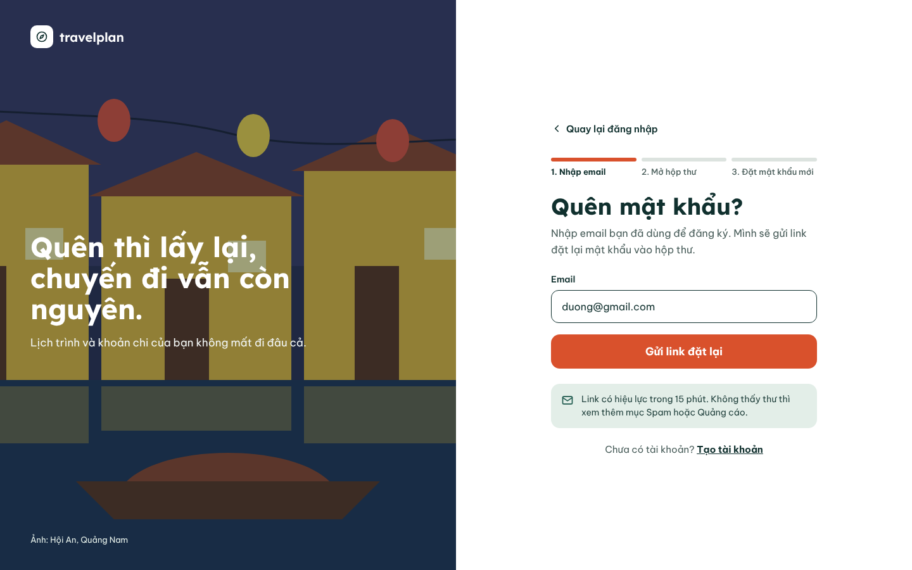

*Screen 12: Quên mật khẩu*

**Luồng hoạt động**

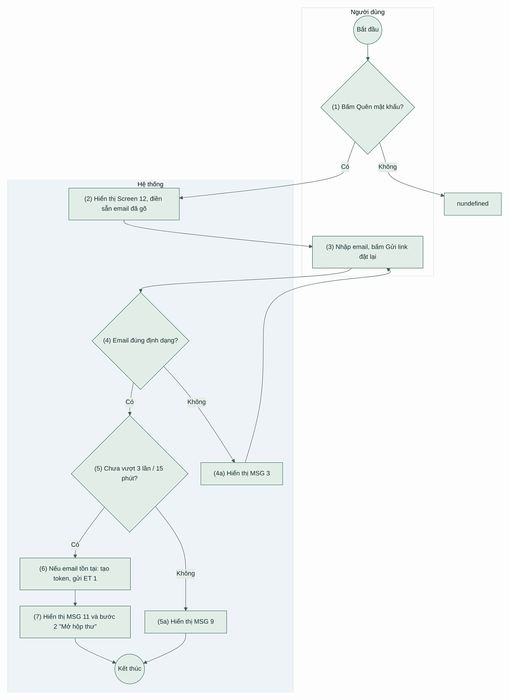

*Hình 17: Luồng hoạt động UC 4: Quên mật khẩu*

**Quy tắc nghiệp vụ**

<table>
<colgroup>
<col style="width: 9%" />
<col style="width: 11%" />
<col style="width: 79%" />
</colgroup>
<thead>
<tr class="header">
<th><strong>Bước</strong></th>
<th><strong>Mã BR</strong></th>
<th><strong>Mô tả</strong></th>
</tr>
<tr class="odd">
<th>(2)</th>
<th>BR 13</th>
<th>
<strong><u>Quy tắc hiển thị:</u></strong>

Hệ thống hiển thị Screen 12 ở bước 1 "Nhập email". Nếu Screen 10 đã
có email, điền sẵn email đó.
</th>
</tr>
<tr class="header">
<th>(5)</th>
<th>BR 14</th>
<th>
<strong><u>Quy tắc giới hạn:</u></strong>

Tối đa 3 yêu cầu cho một email trong 15 phút. Vượt → MSG 9.
</th>
</tr>
<tr class="odd">
<th>(6)</th>
<th>BR 15</th>
<th>
<strong><u>Quy tắc tạo token:</u></strong>

Hệ thống:

<ul>
<li>
Tạo chuỗi ngẫu nhiên 32 byte, chỉ lưu SHA-256 của chuỗi vào
password_reset_tokens với [Hết hạn] = &lt;&lt;Hiện tại&gt;&gt; + 15
phút.
</li>
<li>
Hủy các token cũ chưa dùng của user này.
</li>
<li>
Gửi email theo ET 1.
</li>
<li>
Email không tồn tại thì không làm gì nhưng vẫn trả kết quả như
thành công.
</li>
</ul></th>
</tr>
<tr class="header">
<th>(7)</th>
<th>BR 16</th>
<th>
<strong><u>Quy tắc hiển thị kết quả:</u></strong>

Luôn hiển thị MSG 11 (không tiết lộ email có tồn tại hay không). Nút
[Gửi lại] bị khóa và đếm ngược 60 giây.
</th>
</tr>
</thead>
<tbody>
</tbody>
</table>

UC 5: Đặt lại mật khẩu

| **Mục tiêu:**            | Cho phép người dùng đặt mật khẩu mới từ link trong email. |
|--------------------------|-----------------------------------------------------------|
| **Tác nhân:**            | Khách                                                     |
| **Điều kiện kích hoạt:** | Người dùng bấm link trong email ET 1.                     |
| **Tiền điều kiện:**      | Người dùng có link đặt lại mật khẩu.                      |
| **Hậu điều kiện:**       | Mật khẩu được đổi, token bị hủy.                          |

**Màn hình thiết kế**

*Screen 13: Đặt mật khẩu mới – chưa có thiết kế riêng. Chưa có thiết kế
riêng: dùng bố cục của Screen 12 với thanh bước ở bước 3.*

*Screen 13: Đặt mật khẩu mới*

**Luồng hoạt động**

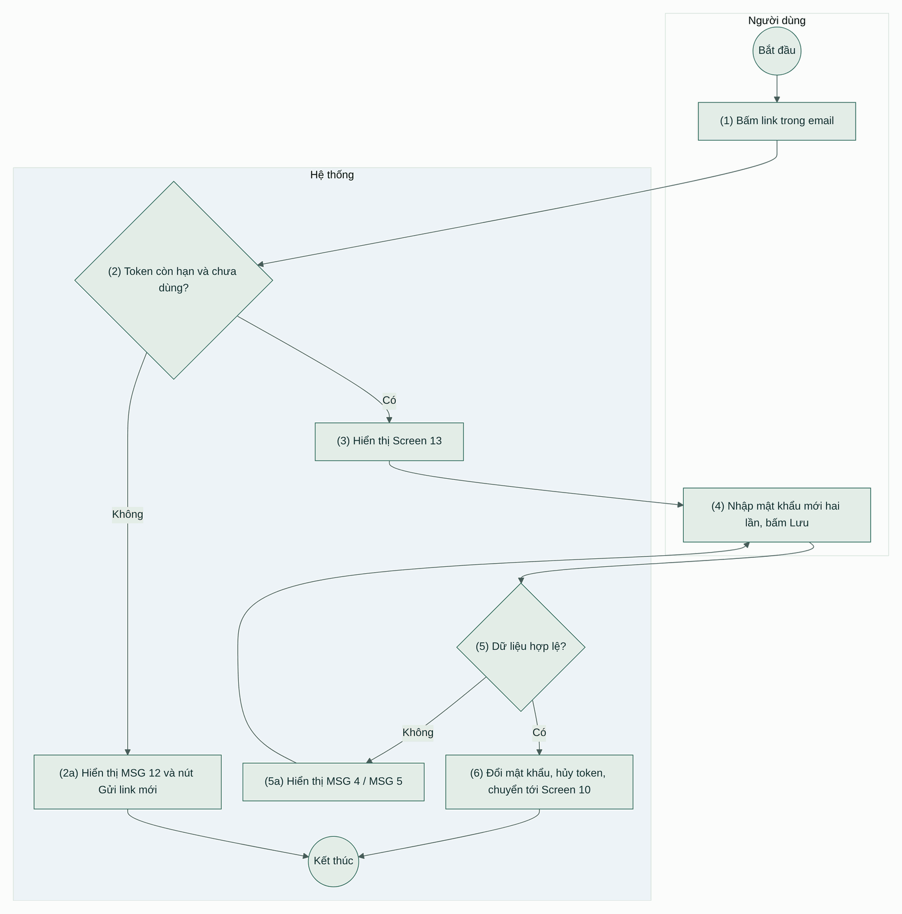

*Hình 18: Luồng hoạt động UC 5: Đặt lại mật khẩu*

**Quy tắc nghiệp vụ**

<table>
<colgroup>
<col style="width: 9%" />
<col style="width: 11%" />
<col style="width: 79%" />
</colgroup>
<thead>
<tr class="header">
<th><strong>Bước</strong></th>
<th><strong>Mã BR</strong></th>
<th><strong>Mô tả</strong></th>
</tr>
<tr class="odd">
<th>(2)</th>
<th>BR 17</th>
<th>
<strong><u>Quy tắc kiểm tra token:</u></strong>

Hệ thống băm token trên URL bằng SHA-256 và tìm bản ghi có [Đã dùng
lúc] trống và [Hết hạn] &gt; hiện tại. Không có → MSG 12.
</th>
</tr>
<tr class="header">
<th>(5)</th>
<th>BR 18</th>
<th>
<strong><u>Quy tắc kiểm tra:</u></strong>

Mật khẩu mới 6–100 ký tự (MSG 4), hai ô trùng nhau (MSG 5).
</th>
</tr>
<tr class="odd">
<th>(6)</th>
<th>BR 19</th>
<th>
<strong><u>Quy tắc cập nhật:</u></strong>

Hệ thống lưu mật khẩu mới đã băm BCrypt, ghi [Đã dùng lúc] =
&lt;&lt;Hiện tại&gt;&gt;, chuyển tới Screen 10 và hiển thị MSG
13.
</th>
</tr>
</thead>
<tbody>
</tbody>
</table>

3.2 Khám phá

UC 6: Tìm lịch trình từ Trang chủ

| **Mục tiêu:**            | Cho phép người dùng tìm lịch trình mẫu theo điểm đến, ngày đi, số ngày và ngân sách. |
|--------------------------|--------------------------------------------------------------------------------------|
| **Tác nhân:**            | Khách, Thành viên                                                                    |
| **Điều kiện kích hoạt:** | Người dùng bấm "Tìm lịch trình" trên khung tìm kiếm của Trang chủ.                   |
| **Tiền điều kiện:**      | Không có.                                                                            |
| **Hậu điều kiện:**       | Danh sách lịch trình mẫu phù hợp được hiển thị.                                      |

**Màn hình thiết kế**

*Screen 1: Trang chủ (5 phần ghép dọc)*

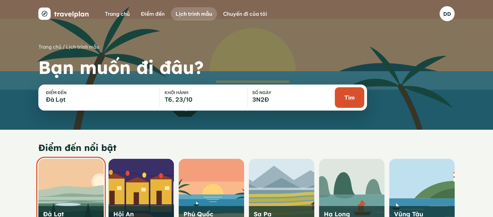

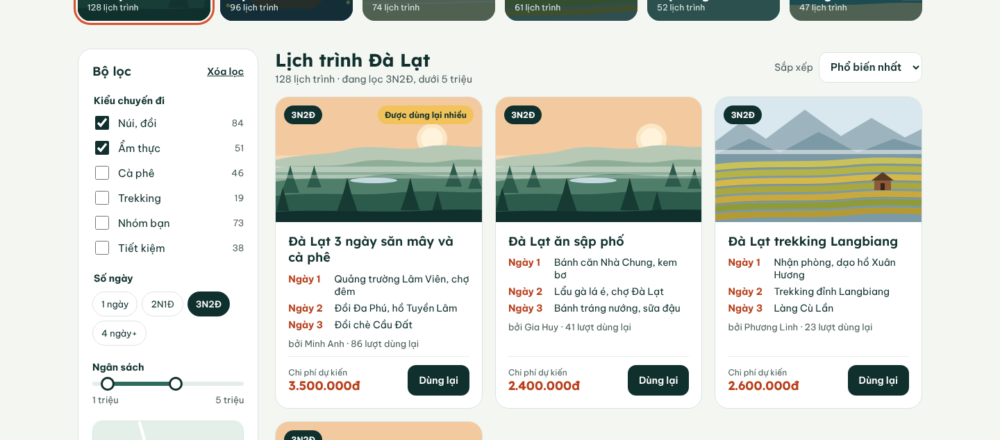

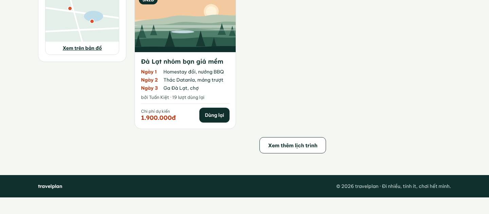

*Screen 2: Lịch trình mẫu (3 phần ghép dọc)*

**Luồng hoạt động**

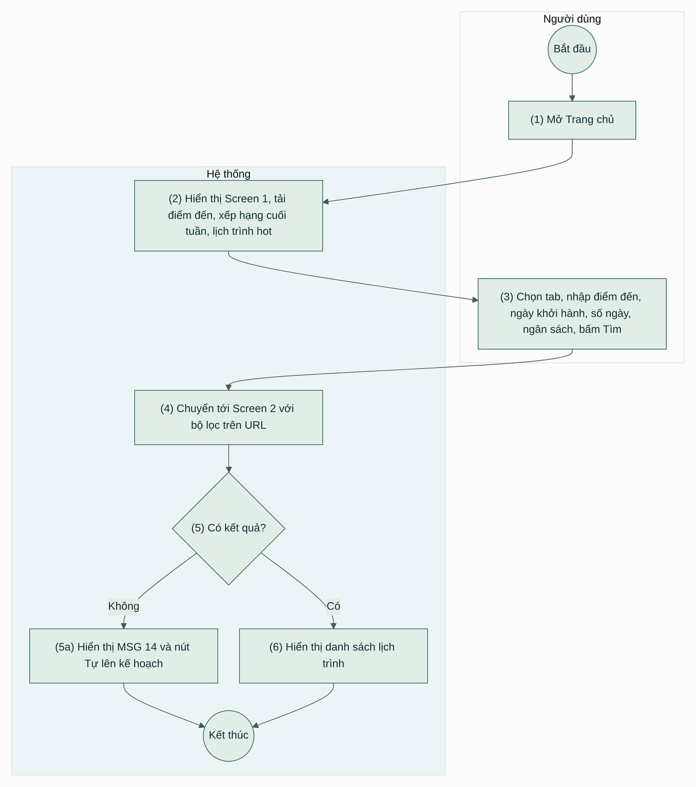

*Hình 19: Luồng hoạt động UC 6: Tìm lịch trình từ Trang chủ*

**Quy tắc nghiệp vụ**

<table>
<colgroup>
<col style="width: 9%" />
<col style="width: 11%" />
<col style="width: 79%" />
</colgroup>
<thead>
<tr class="header">
<th><strong>Bước</strong></th>
<th><strong>Mã BR</strong></th>
<th><strong>Mô tả</strong></th>
</tr>
<tr class="odd">
<th>(2)</th>
<th>BR 20</th>
<th>
<strong><u>Quy tắc hiển thị:</u></strong>

Hệ thống gọi song song: /api/public/destinations?size=6,
/api/public/trending-destinations, /api/public/itineraries?size=6. Mỗi
khối có skeleton riêng; khối nào lỗi thì ẩn khối đó.
</th>
</tr>
<tr class="header">
<th>(3)</th>
<th>BR 21</th>
<th>
<strong><u>Quy tắc tab tìm kiếm:</u></strong>

Tab [Lịch trình mẫu] tìm lịch trình; tab [Điểm đến] chuyển tới Screen
3 với từ khóa; tab [Tự lên chuyến mới] chuyển tới Screen 6 với điểm đến
và ngày điền sẵn (cần đăng nhập theo CBR 3).
</th>
</tr>
<tr class="odd">
<th>(4)</th>
<th>BR 22</th>
<th>
<strong><u>Quy tắc truyền tham số:</u></strong>

URL:
/lich-trinh-mau?destination=&lt;slug&gt;&amp;start=&lt;yyyy-mm-dd&gt;&amp;days=&lt;n&gt;&amp;budgetMax=&lt;số&gt;.
Ô để trống thì bỏ tham số tương ứng.
</th>
</tr>
<tr class="header">
<th>(5)</th>
<th>BR 23</th>
<th>
<strong><u>Quy tắc kết quả rỗng:</u></strong>

Không có kết quả → MSG 14, nút [Tự lên kế hoạch] mở Screen 6 điền sẵn
điểm đến và ngày.
</th>
</tr>
</thead>
<tbody>
</tbody>
</table>

UC 7: Xem và lọc lịch trình mẫu

| **Mục tiêu:**            | Cho phép người dùng duyệt các lịch trình công khai của cộng đồng. |
|--------------------------|-------------------------------------------------------------------|
| **Tác nhân:**            | Khách, Thành viên                                                 |
| **Điều kiện kích hoạt:** | Người dùng mở menu "Lịch trình mẫu".                              |
| **Tiền điều kiện:**      | Không có.                                                         |
| **Hậu điều kiện:**       | Danh sách lịch trình theo bộ lọc được hiển thị.                   |

**Màn hình thiết kế**

*Screen 2: Lịch trình mẫu (3 phần ghép dọc)*

**Luồng hoạt động**

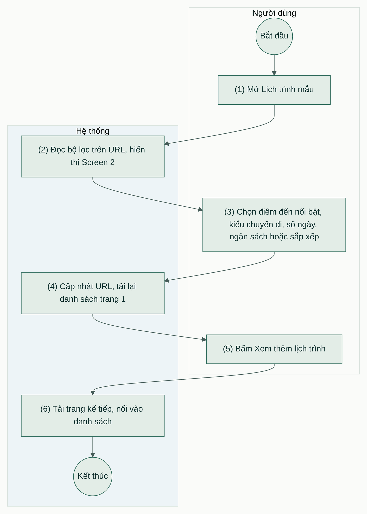

*Hình 20: Luồng hoạt động UC 7: Xem và lọc lịch trình mẫu*

**Quy tắc nghiệp vụ**

<table>
<colgroup>
<col style="width: 9%" />
<col style="width: 11%" />
<col style="width: 79%" />
</colgroup>
<thead>
<tr class="header">
<th><strong>Bước</strong></th>
<th><strong>Mã BR</strong></th>
<th><strong>Mô tả</strong></th>
</tr>
<tr class="odd">
<th>(2)</th>
<th>BR 24</th>
<th>
<strong><u>Quy tắc hiển thị:</u></strong>

Mỗi trang 12 thẻ. Thẻ gồm ảnh bìa, nhãn số ngày (3N2Đ), tên, 3 ngày
đầu tiên của lịch trình, tên người tạo (2 chữ cuối của họ tên), số lượt
dùng lại, chi phí dự kiến, nút [Dùng lại].
</th>
</tr>
<tr class="header">
<th>(3)</th>
<th>BR 25</th>
<th>
<strong><u>Quy tắc lọc:</u></strong>

Kiểu chuyến đi lọc theo tag (chọn nhiều, điều kiện HOẶC). Số ngày: 1
ngày / 2N1Đ / 3N2Đ / 4 ngày+. Ngân sách: thanh kéo 1–5 triệu. [Xóa lọc]
bỏ toàn bộ bộ lọc.
</th>
</tr>
<tr class="odd">
<th>(3)</th>
<th>BR 26</th>
<th>
<strong><u>Quy tắc sắp xếp:</u></strong>

Phổ biến nhất (clone_count giảm dần), Mới nhất (created_at giảm dần),
Rẻ nhất (budget tăng dần).
</th>
</tr>
<tr class="header">
<th>(6)</th>
<th>BR 27</th>
<th>
<strong><u>Quy tắc phân trang:</u></strong>

Hết dữ liệu thì ẩn nút [Xem thêm lịch trình].
</th>
</tr>
</thead>
<tbody>
</tbody>
</table>

UC 8: Xem danh sách điểm đến

| **Mục tiêu:**            | Cho phép người dùng xem các điểm đến trong nước theo vùng và theo mùa. |
|--------------------------|------------------------------------------------------------------------|
| **Tác nhân:**            | Khách, Thành viên                                                      |
| **Điều kiện kích hoạt:** | Người dùng mở menu "Điểm đến".                                         |
| **Tiền điều kiện:**      | Không có.                                                              |
| **Hậu điều kiện:**       | Danh sách điểm đến được hiển thị.                                      |

**Màn hình thiết kế**

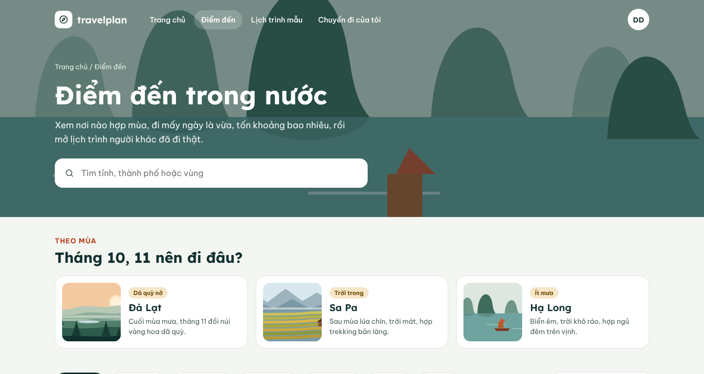

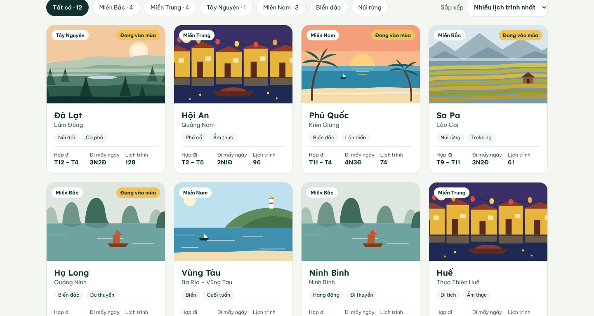

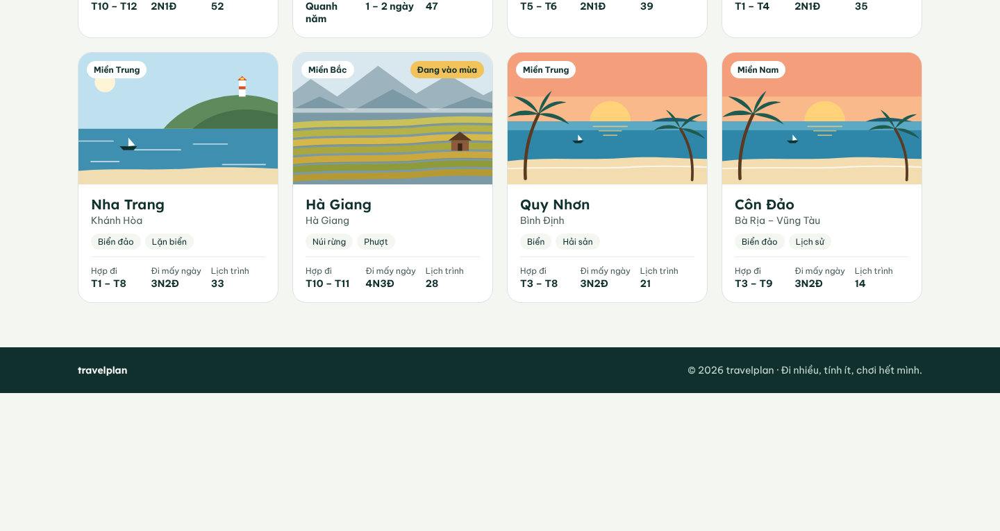

*Screen 3: Điểm đến (3 phần ghép dọc)*

**Luồng hoạt động**

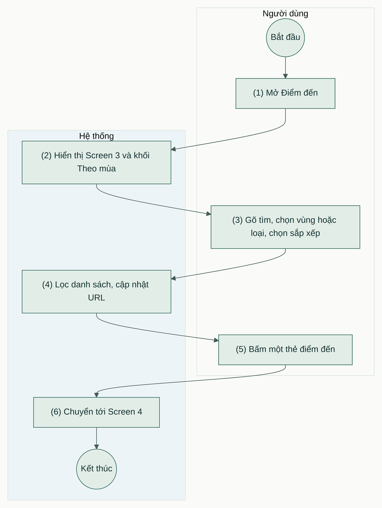

*Hình 21: Luồng hoạt động UC 8: Xem danh sách điểm đến*

**Quy tắc nghiệp vụ**

<table>
<colgroup>
<col style="width: 9%" />
<col style="width: 11%" />
<col style="width: 79%" />
</colgroup>
<thead>
<tr class="header">
<th><strong>Bước</strong></th>
<th><strong>Mã BR</strong></th>
<th><strong>Mô tả</strong></th>
</tr>
<tr class="odd">
<th>(2)</th>
<th>BR 28</th>
<th>
<strong><u>Quy tắc theo mùa:</u></strong>

Khối "Tháng x, y nên đi đâu?" lấy 3 điểm đến có tháng hiện tại hoặc
tháng sau nằm trong [Tháng đẹp].
</th>
</tr>
<tr class="header">
<th>(2)</th>
<th>BR 29</th>
<th>
<strong><u>Quy tắc nhãn:</u></strong>

Nhãn "Đang vào mùa" hiện khi tháng hiện tại thuộc [Tháng đẹp] của
điểm đến.
</th>
</tr>
<tr class="odd">
<th>(3)</th>
<th>BR 30</th>
<th>
<strong><u>Quy tắc tìm kiếm:</u></strong>

Tìm theo tên điểm đến, tỉnh hoặc vùng, không phân biệt dấu và hoa
thường.
</th>
</tr>
<tr class="header">
<th>(4)</th>
<th>BR 31</th>
<th>
<strong><u>Quy tắc lọc:</u></strong>

Chip vùng: Tất cả, Miền Bắc, Miền Trung, Tây Nguyên, Miền Nam, kèm số
lượng; chip loại: Biển đảo, Núi rừng. Sắp xếp: Nhiều lịch trình nhất,
Tên A–Z.
</th>
</tr>
</thead>
<tbody>
</tbody>
</table>

UC 9: Xem chi tiết điểm đến

| **Mục tiêu:**            | Cho phép người dùng xem thông tin, địa điểm nên ghé, lịch trình mẫu và chi phí tham khảo của một điểm đến. |
|--------------------------|------------------------------------------------------------------------------------------------------------|
| **Tác nhân:**            | Khách, Thành viên                                                                                          |
| **Điều kiện kích hoạt:** | Người dùng bấm thẻ điểm đến ở Screen 1 hoặc Screen 3.                                                      |
| **Tiền điều kiện:**      | Không có.                                                                                                  |
| **Hậu điều kiện:**       | Chi tiết điểm đến được hiển thị.                                                                           |

**Màn hình thiết kế**

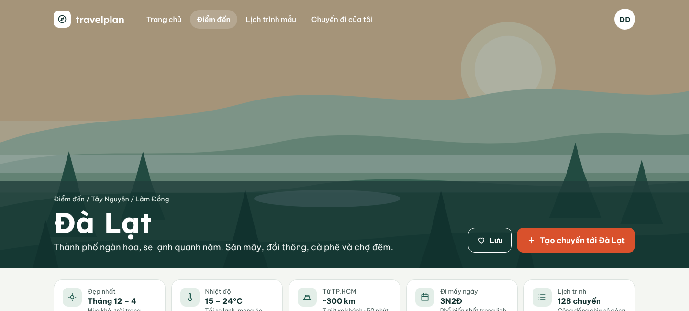

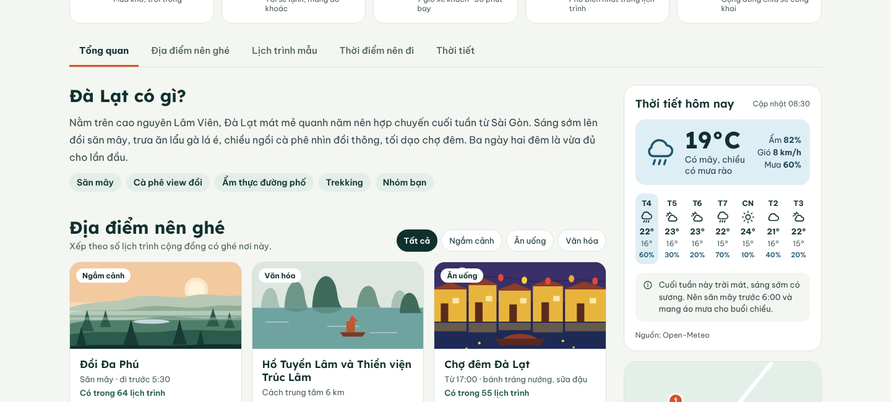

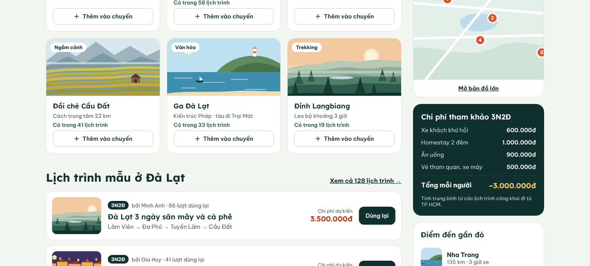

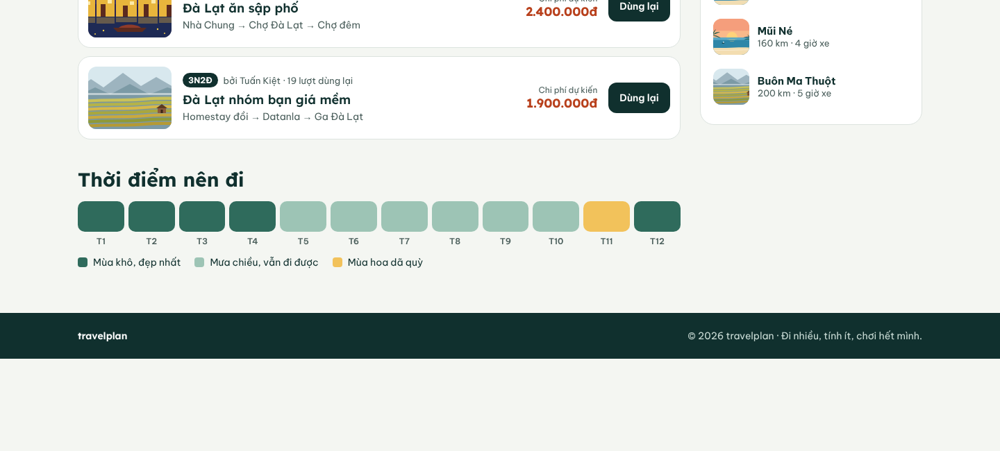

*Screen 4: Chi tiết điểm đến (4 phần ghép dọc)*

**Luồng hoạt động**

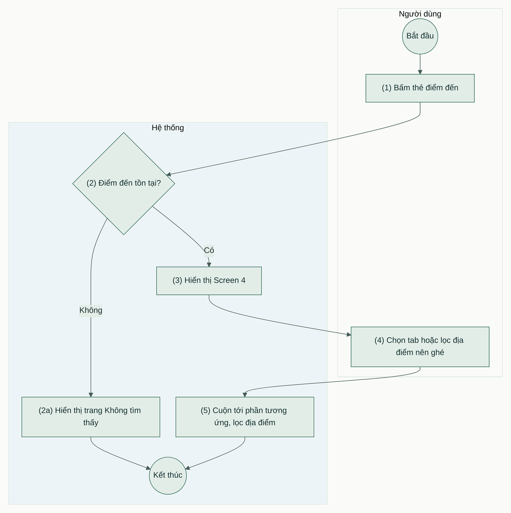

*Hình 22: Luồng hoạt động UC 9: Xem chi tiết điểm đến*

**Quy tắc nghiệp vụ**

<table>
<colgroup>
<col style="width: 9%" />
<col style="width: 11%" />
<col style="width: 79%" />
</colgroup>
<thead>
<tr class="header">
<th><strong>Bước</strong></th>
<th><strong>Mã BR</strong></th>
<th><strong>Mô tả</strong></th>
</tr>
<tr class="odd">
<th>(3)</th>
<th>BR 32</th>
<th>
<strong><u>Quy tắc hiển thị:</u></strong>

Hệ thống gọi /api/public/destinations/{slug} và hiển thị: hero, 5 thẻ
thông tin nhanh (Đẹp nhất, Nhiệt độ, Từ TP.HCM, Đi mấy ngày, Lịch
trình), mô tả, địa điểm nên ghé, 3 lịch trình mẫu, chi phí tham khảo
3N2Đ, điểm đến gần đó, biểu đồ thời điểm nên đi. Khối thời tiết theo UC
10.
</th>
</tr>
<tr class="header">
<th>(4)</th>
<th>BR 33</th>
<th>
<strong><u>Quy tắc tab:</u></strong>

Các tab Tổng quan, Địa điểm nên ghé, Lịch trình mẫu, Thời điểm nên
đi, Thời tiết là neo cuộn trong cùng trang.
</th>
</tr>
<tr class="odd">
<th>(5)</th>
<th>BR 34</th>
<th>
<strong><u>Quy tắc lọc địa điểm:</u></strong>

Chip Tất cả / Ngắm cảnh / Ăn uống / Văn hóa lọc theo [Loại] của địa
điểm.
</th>
</tr>
</thead>
<tbody>
</tbody>
</table>

UC 10: Xem thời tiết điểm đến

| **Mục tiêu:**            | Cho phép người dùng xem thời tiết hiện tại và dự báo 7 ngày của điểm đến. |
|--------------------------|---------------------------------------------------------------------------|
| **Tác nhân:**            | Khách, Thành viên                                                         |
| **Điều kiện kích hoạt:** | Screen 4 được mở.                                                         |
| **Tiền điều kiện:**      | Điểm đến có tọa độ.                                                       |
| **Hậu điều kiện:**       | Khối thời tiết được hiển thị hoặc được ẩn nếu lỗi.                        |

**Màn hình thiết kế**

*Screen 4: Chi tiết điểm đến (4 phần ghép dọc)*

**Luồng hoạt động**

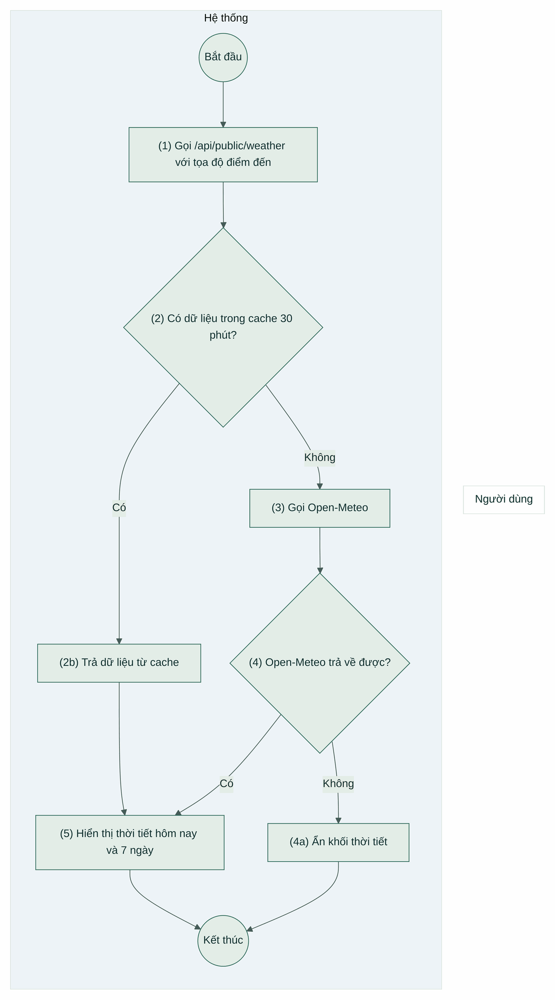

*Hình 23: Luồng hoạt động UC 10: Xem thời tiết điểm đến*

**Quy tắc nghiệp vụ**

<table>
<colgroup>
<col style="width: 9%" />
<col style="width: 11%" />
<col style="width: 79%" />
</colgroup>
<thead>
<tr class="header">
<th><strong>Bước</strong></th>
<th><strong>Mã BR</strong></th>
<th><strong>Mô tả</strong></th>
</tr>
<tr class="odd">
<th>(2)</th>
<th>BR 35</th>
<th>
<strong><u>Quy tắc cache:</u></strong>

Khóa cache là tọa độ làm tròn 2 chữ số thập phân, hạn 30
phút.
</th>
</tr>
<tr class="header">
<th>(4)</th>
<th>BR 36</th>
<th>
<strong><u>Quy tắc lỗi:</u></strong>

Open-Meteo lỗi hoặc quá 3 giây → server trả 502, client ẩn khối thời
tiết, không hiện thông báo lỗi.
</th>
</tr>
<tr class="odd">
<th>(5)</th>
<th>BR 37</th>
<th>
<strong><u>Quy tắc hiển thị:</u></strong>

Hiện nhiệt độ, mô tả, độ ẩm, gió, khả năng mưa; 7 ngày gồm thứ, icon,
cao/thấp, % mưa. Mô tả đổi từ mã WMO theo CBR 5. Ghi "Nguồn: Open-Meteo"
và giờ cập nhật.
</th>
</tr>
</thead>
<tbody>
</tbody>
</table>

UC 11: Dùng lại lịch trình mẫu

| **Mục tiêu:**            | Cho phép thành viên chép một lịch trình công khai thành chuyến đi của mình. |
|--------------------------|-----------------------------------------------------------------------------|
| **Tác nhân:**            | Thành viên                                                                  |
| **Điều kiện kích hoạt:** | Người dùng bấm "Dùng lại" trên thẻ lịch trình (Screen 1, 2, 4).             |
| **Tiền điều kiện:**      | Lịch trình đang công khai.                                                  |
| **Hậu điều kiện:**       | Một chuyến đi mới thuộc người dùng được tạo.                                |

**Màn hình thiết kế**

*Screen 1: Trang chủ (5 phần ghép dọc)*

*Screen 2: Lịch trình mẫu (3 phần ghép dọc)*

*Screen 4: Chi tiết điểm đến (4 phần ghép dọc)*

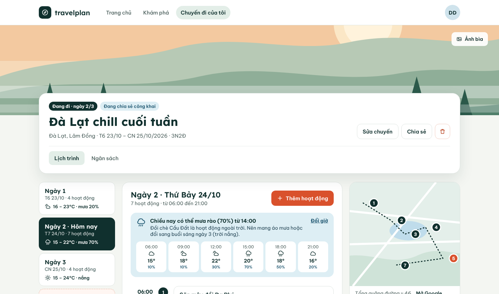

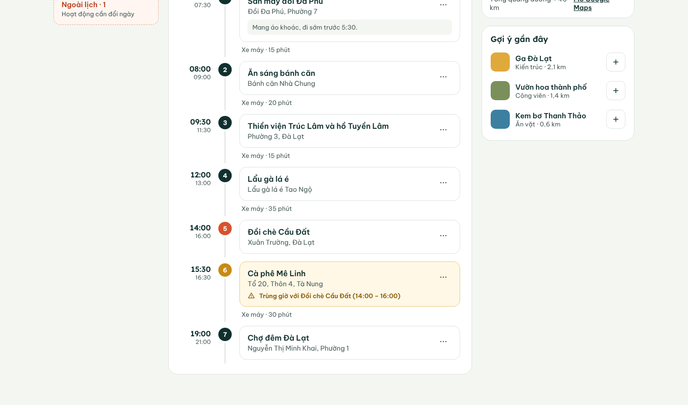

*Screen 7: Lịch trình chuyến (2 phần ghép dọc)*

**Luồng hoạt động**

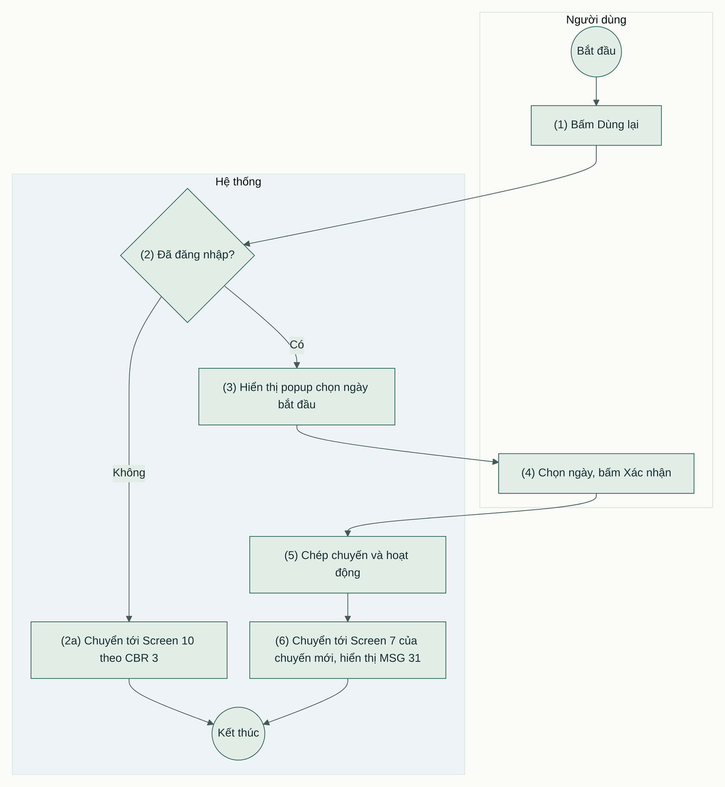

*Hình 24: Luồng hoạt động UC 11: Dùng lại lịch trình mẫu*

**Quy tắc nghiệp vụ**

<table>
<colgroup>
<col style="width: 9%" />
<col style="width: 11%" />
<col style="width: 79%" />
</colgroup>
<thead>
<tr class="header">
<th><strong>Bước</strong></th>
<th><strong>Mã BR</strong></th>
<th><strong>Mô tả</strong></th>
</tr>
<tr class="odd">
<th>(3)</th>
<th>BR 38</th>
<th>
<strong><u>Quy tắc popup:</u></strong>

Popup hiển thị tên lịch trình, số ngày, ô [Ngày bắt đầu] mặc định là
thứ Bảy gần nhất, [Ngày kết thúc] tự tính, không sửa được.
</th>
</tr>
<tr class="header">
<th>(5)</th>
<th>BR 39</th>
<th>
<strong><u>Quy tắc sao chép:</u></strong>

Hệ thống:

<ul>
<li>
Tạo trip mới thuộc người dùng, tên giữ nguyên, [Công khai] =
Không, [Sao chép từ] = id gốc.
</li>
<li>
Chép mọi hoạt động, dời ngày theo độ lệch giữa ngày bắt đầu mới
và cũ.
</li>
<li>
Không chép khoản chi, ảnh bìa giữ nguyên.
</li>
<li>
Tăng [Số lần dùng lại] của chuyến gốc thêm 1.
</li>
</ul></th>
</tr>
</thead>
<tbody>
</tbody>
</table>

UC 12: Lưu / bỏ lưu

| **Mục tiêu:**            | Cho phép thành viên lưu lịch trình hoặc điểm đến để xem lại. |
|--------------------------|--------------------------------------------------------------|
| **Tác nhân:**            | Thành viên                                                   |
| **Điều kiện kích hoạt:** | Người dùng bấm biểu tượng tim hoặc nút "Lưu".                |
| **Tiền điều kiện:**      | Không có.                                                    |
| **Hậu điều kiện:**       | Mục được lưu hoặc bỏ lưu.                                    |

**Màn hình thiết kế**

*Screen 1: Trang chủ (5 phần ghép dọc)*

*Screen 2: Lịch trình mẫu (3 phần ghép dọc)*

*Screen 4: Chi tiết điểm đến (4 phần ghép dọc)*

**Luồng hoạt động**

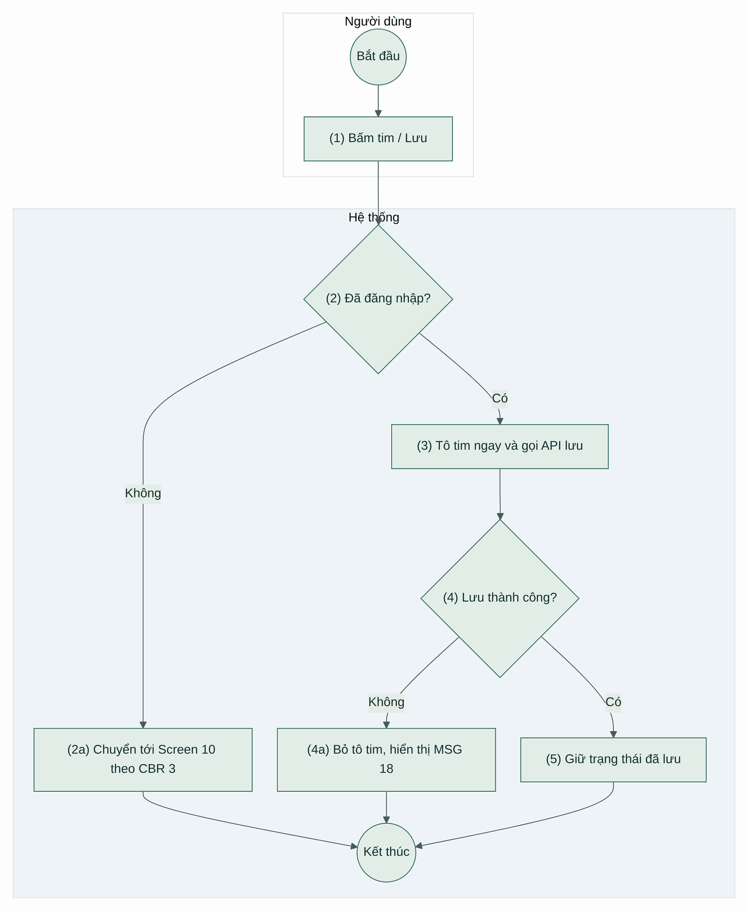

*Hình 25: Luồng hoạt động UC 12: Lưu / bỏ lưu*

**Quy tắc nghiệp vụ**

<table>
<colgroup>
<col style="width: 9%" />
<col style="width: 11%" />
<col style="width: 79%" />
</colgroup>
<thead>
<tr class="header">
<th><strong>Bước</strong></th>
<th><strong>Mã BR</strong></th>
<th><strong>Mô tả</strong></th>
</tr>
<tr class="odd">
<th>(3)</th>
<th>BR 40</th>
<th>
<strong><u>Quy tắc lưu:</u></strong>

Mỗi người dùng chỉ lưu một mục một lần (unique user + loại + id). Bấm
lại khi đã lưu → bỏ lưu.
</th>
</tr>
<tr class="header">
<th>(2a)</th>
<th>BR 41</th>
<th>
<strong><u>Quy tắc quay lại:</u></strong>

Sau khi đăng nhập, hệ thống quay lại trang cũ và tự lưu mục vừa bấm
(action=save).
</th>
</tr>
</thead>
<tbody>
</tbody>
</table>

3.3 Chuyến đi

UC 13: Xem danh sách chuyến đi

| **Mục tiêu:**            | Cho phép thành viên xem các chuyến của mình. |
|--------------------------|----------------------------------------------|
| **Tác nhân:**            | Thành viên                                   |
| **Điều kiện kích hoạt:** | Người dùng mở menu "Chuyến đi của tôi".      |
| **Tiền điều kiện:**      | Người dùng đã đăng nhập.                     |
| **Hậu điều kiện:**       | Danh sách chuyến được hiển thị.              |

**Màn hình thiết kế**

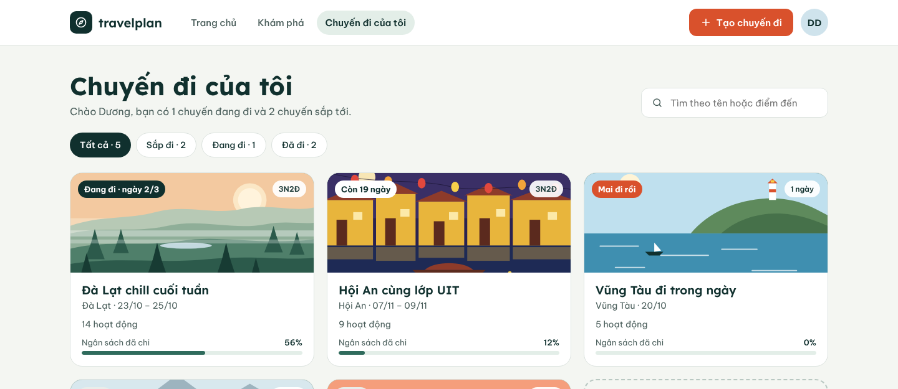

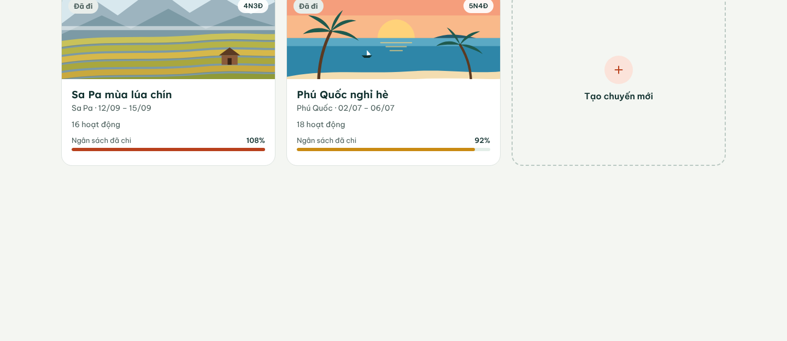

*Screen 5: Chuyến đi của tôi (2 phần ghép dọc)*

**Luồng hoạt động**

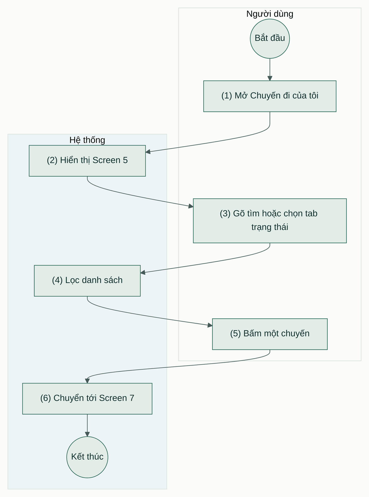

*Hình 26: Luồng hoạt động UC 13: Xem danh sách chuyến đi*

**Quy tắc nghiệp vụ**

<table>
<colgroup>
<col style="width: 9%" />
<col style="width: 11%" />
<col style="width: 79%" />
</colgroup>
<thead>
<tr class="header">
<th><strong>Bước</strong></th>
<th><strong>Mã BR</strong></th>
<th><strong>Mô tả</strong></th>
</tr>
<tr class="odd">
<th>(2)</th>
<th>BR 42</th>
<th>
<strong><u>Quy tắc hiển thị:</u></strong>

Thẻ chuyến gồm ảnh/màu bìa, nhãn trạng thái theo CBR 4, số ngày, tên,
điểm đến, ngày, số hoạt động, thanh ngân sách đã chi theo CBR 6. Câu
chào "Chào &lt;tên&gt;, bạn có x chuyến đang đi và y chuyến sắp
tới."
</th>
</tr>
<tr class="header">
<th>(2)</th>
<th>BR 43</th>
<th>
<strong><u>Quy tắc rỗng:</u></strong>

Chưa có chuyến nào → MSG 15 kèm nút [Tạo chuyến đi]. Luôn có thẻ "Tạo
chuyến mới" ở cuối lưới.
</th>
</tr>
<tr class="odd">
<th>(4)</th>
<th>BR 44</th>
<th>
<strong><u>Quy tắc lọc:</u></strong>

Tab Tất cả / Sắp đi / Đang đi / Đã đi kèm số lượng. Tìm theo tên
chuyến hoặc điểm đến.
</th>
</tr>
</thead>
<tbody>
</tbody>
</table>

UC 14: Tạo chuyến đi

| **Mục tiêu:**            | Cho phép thành viên tạo chuyến đi mới.                                               |
|--------------------------|--------------------------------------------------------------------------------------|
| **Tác nhân:**            | Thành viên                                                                           |
| **Điều kiện kích hoạt:** | Người dùng bấm "Tạo chuyến đi", "Tạo chuyến mới" hoặc "Tạo chuyến tới \<điểm đến\>". |
| **Tiền điều kiện:**      | Người dùng đã đăng nhập.                                                             |
| **Hậu điều kiện:**       | Chuyến đi mới được tạo.                                                              |

**Màn hình thiết kế**

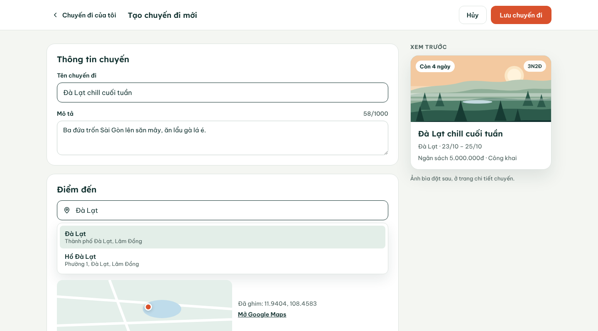

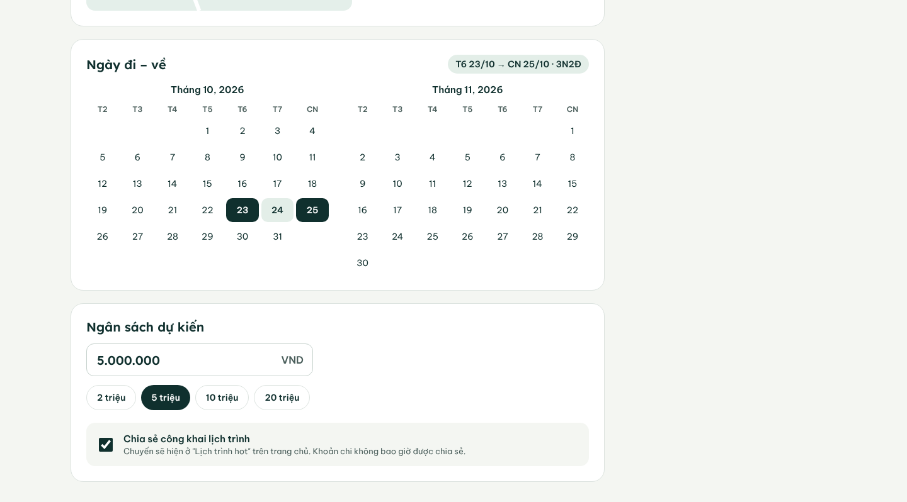

*Screen 6: Tạo / sửa chuyến đi (2 phần ghép dọc)*

**Luồng hoạt động**

*Hình 27: Luồng hoạt động UC 14: Tạo chuyến đi*

**Quy tắc nghiệp vụ**

<table>
<colgroup>
<col style="width: 9%" />
<col style="width: 11%" />
<col style="width: 79%" />
</colgroup>
<thead>
<tr class="header">
<th><strong>Bước</strong></th>
<th><strong>Mã BR</strong></th>
<th><strong>Mô tả</strong></th>
</tr>
<tr class="odd">
<th>(2)</th>
<th>BR 45</th>
<th>
<strong><u>Quy tắc điền sẵn:</u></strong>

Mở từ Screen 4 (?destination=slug) → điền tên điểm đến, địa chỉ, tọa
độ; ngày về = ngày đi + số ngày gợi ý − 1.
</th>
</tr>
<tr class="header">
<th>(3)</th>
<th>BR 46</th>
<th>
<strong><u>Quy tắc chọn điểm đến:</u></strong>

Gõ ≥ 2 ký tự → gợi ý địa điểm từ Nominatim (tối đa 5). Chọn gợi ý →
lưu [Địa chỉ], [Vĩ độ], [Kinh độ], hiện bản đồ ghim và link Google
Maps.
</th>
</tr>
<tr class="odd">
<th>(6)</th>
<th>BR 47</th>
<th>
<strong><u>Quy tắc kiểm tra:</u></strong>

Theo CBR 1 và CBR 2.
</th>
</tr>
<tr class="header">
<th>(7)</th>
<th>BR 48</th>
<th>
<strong><u>Quy tắc tạo mới:</u></strong>

Lưu trip thuộc người dùng trong JWT, [Ngày tạo] = &lt;&lt;Hiện
tại&gt;&gt;. Ảnh bìa đặt sau ở Screen 7.
</th>
</tr>
<tr class="odd">
<th>(5)</th>
<th>BR 49</th>
<th>
<strong><u>Quy tắc hủy:</u></strong>

[Hủy] khi form đã có thay đổi → popup MSG 25.
</th>
</tr>
</thead>
<tbody>
</tbody>
</table>

UC 15: Sửa chuyến đi

| **Mục tiêu:**            | Cho phép thành viên sửa thông tin chuyến.  |
|--------------------------|--------------------------------------------|
| **Tác nhân:**            | Thành viên                                 |
| **Điều kiện kích hoạt:** | Người dùng bấm "Sửa chuyến" trên Screen 7. |
| **Tiền điều kiện:**      | Người dùng là chủ chuyến.                  |
| **Hậu điều kiện:**       | Thông tin chuyến được cập nhật.            |

**Màn hình thiết kế**

*Screen 6: Tạo / sửa chuyến đi (2 phần ghép dọc)*

*Screen 7: Lịch trình chuyến (2 phần ghép dọc)*

**Luồng hoạt động**

*Hình 28: Luồng hoạt động UC 15: Sửa chuyến đi*

**Quy tắc nghiệp vụ**

<table>
<colgroup>
<col style="width: 9%" />
<col style="width: 11%" />
<col style="width: 79%" />
</colgroup>
<thead>
<tr class="header">
<th><strong>Bước</strong></th>
<th><strong>Mã BR</strong></th>
<th><strong>Mô tả</strong></th>
</tr>
<tr class="odd">
<th>(2)</th>
<th>BR 50</th>
<th>
<strong><u>Quy tắc phân quyền:</u></strong>

Chuyến không thuộc người dùng → trang Không tìm thấy (server trả
404).
</th>
</tr>
<tr class="header">
<th>(4)</th>
<th>BR 51</th>
<th>
<strong><u>Quy tắc kiểm tra:</u></strong>

Theo CBR 1 và CBR 2.
</th>
</tr>
<tr class="odd">
<th>(6)</th>
<th>BR 52</th>
<th>
<strong><u>Quy tắc Ngoài lịch:</u></strong>

Hoạt động có [Ngày] nằm ngoài [Ngày đi]–[Ngày về] mới không bị xóa mà
hiển thị ở nhóm "Ngoài lịch" (Screen 7).
</th>
</tr>
</thead>
<tbody>
</tbody>
</table>

UC 16: Xóa chuyến đi

| **Mục tiêu:**            | Cho phép thành viên xóa một chuyến.         |
|--------------------------|---------------------------------------------|
| **Tác nhân:**            | Thành viên                                  |
| **Điều kiện kích hoạt:** | Người dùng bấm nút thùng rác trên Screen 7. |
| **Tiền điều kiện:**      | Người dùng là chủ chuyến.                   |
| **Hậu điều kiện:**       | Chuyến, hoạt động và khoản chi bị xóa.      |

**Màn hình thiết kế**

*Screen 7: Lịch trình chuyến (2 phần ghép dọc)*

**Luồng hoạt động**

*Hình 29: Luồng hoạt động UC 16: Xóa chuyến đi*

**Quy tắc nghiệp vụ**

<table>
<colgroup>
<col style="width: 9%" />
<col style="width: 11%" />
<col style="width: 79%" />
</colgroup>
<thead>
<tr class="header">
<th><strong>Bước</strong></th>
<th><strong>Mã BR</strong></th>
<th><strong>Mô tả</strong></th>
</tr>
<tr class="odd">
<th>(2)</th>
<th>BR 53</th>
<th>
<strong><u>Quy tắc popup:</u></strong>

Popup MSG 24 liệt kê số hoạt động và số khoản chi sẽ mất. Nút [Xóa]
màu đỏ.
</th>
</tr>
<tr class="header">
<th>(4)</th>
<th>BR 54</th>
<th>
<strong><u>Quy tắc xóa:</u></strong>

Xóa trip kèm itinerary_items, expenses, trip_tags (cascade). Các
chuyến đã sao chép từ chuyến này vẫn giữ nguyên.
</th>
</tr>
</thead>
<tbody>
</tbody>
</table>

UC 17: Đổi ảnh bìa

| **Mục tiêu:**            | Cho phép thành viên đặt ảnh hoặc màu bìa cho chuyến. |
|--------------------------|------------------------------------------------------|
| **Tác nhân:**            | Thành viên                                           |
| **Điều kiện kích hoạt:** | Người dùng bấm "Ảnh bìa" trên Screen 7.              |
| **Tiền điều kiện:**      | Người dùng là chủ chuyến.                            |
| **Hậu điều kiện:**       | Ảnh bìa được cập nhật.                               |

**Màn hình thiết kế**

*Screen 7: Lịch trình chuyến (2 phần ghép dọc)*

**Luồng hoạt động**

*Hình 30: Luồng hoạt động UC 17: Đổi ảnh bìa*

**Quy tắc nghiệp vụ**

<table>
<colgroup>
<col style="width: 9%" />
<col style="width: 11%" />
<col style="width: 79%" />
</colgroup>
<thead>
<tr class="header">
<th><strong>Bước</strong></th>
<th><strong>Mã BR</strong></th>
<th><strong>Mô tả</strong></th>
</tr>
<tr class="odd">
<th>(4)</th>
<th>BR 55</th>
<th>
<strong><u>Quy tắc tệp:</u></strong>

Chỉ nhận JPG, PNG, WebP, tối đa 5 MB; kiểm tra nội dung tệp, không
chỉ đuôi. Sai → MSG 16.
</th>
</tr>
<tr class="header">
<th>(5)</th>
<th>BR 56</th>
<th>
<strong><u>Quy tắc lưu:</u></strong>

Tệp tải lên được đổi tên ngẫu nhiên. Đặt ảnh thì xóa màu bìa và ngược
lại.
</th>
</tr>
</thead>
<tbody>
</tbody>
</table>

UC 18: Chia sẻ công khai

| **Mục tiêu:**            | Cho phép thành viên bật/tắt công khai lịch trình và chép link chia sẻ.                   |
|--------------------------|------------------------------------------------------------------------------------------|
| **Tác nhân:**            | Thành viên                                                                               |
| **Điều kiện kích hoạt:** | Người dùng tick "Chia sẻ công khai lịch trình" (Screen 6) hoặc bấm "Chia sẻ" (Screen 7). |
| **Tiền điều kiện:**      | Người dùng là chủ chuyến.                                                                |
| **Hậu điều kiện:**       | Trạng thái công khai được cập nhật.                                                      |

**Màn hình thiết kế**

*Screen 6: Tạo / sửa chuyến đi (2 phần ghép dọc)*

*Screen 7: Lịch trình chuyến (2 phần ghép dọc)*

**Luồng hoạt động**

*Hình 31: Luồng hoạt động UC 18: Chia sẻ công khai*

**Quy tắc nghiệp vụ**

<table>
<colgroup>
<col style="width: 9%" />
<col style="width: 11%" />
<col style="width: 79%" />
</colgroup>
<thead>
<tr class="header">
<th><strong>Bước</strong></th>
<th><strong>Mã BR</strong></th>
<th><strong>Mô tả</strong></th>
</tr>
<tr class="odd">
<th>(2)</th>
<th>BR 57</th>
<th>
<strong><u>Quy tắc hiển thị:</u></strong>

Link chỉ chép được khi chuyến đang công khai.
</th>
</tr>
<tr class="header">
<th>(4)</th>
<th>BR 58</th>
<th>
<strong><u>Quy tắc công khai:</u></strong>

Chuyến công khai xuất hiện ở Lịch trình mẫu và Trang chủ. Khoản chi
không bao giờ được công khai; người xem chỉ thấy ngân sách dự
kiến.
</th>
</tr>
</thead>
<tbody>
</tbody>
</table>

3.4 Lịch trình

UC 19: Xem lịch trình theo ngày

| **Mục tiêu:**            | Cho phép thành viên xem hoạt động của từng ngày, thời tiết và bản đồ. |
|--------------------------|-----------------------------------------------------------------------|
| **Tác nhân:**            | Thành viên                                                            |
| **Điều kiện kích hoạt:** | Người dùng mở một chuyến.                                             |
| **Tiền điều kiện:**      | Người dùng là chủ chuyến.                                             |
| **Hậu điều kiện:**       | Lịch trình của ngày được chọn được hiển thị.                          |

**Màn hình thiết kế**

*Screen 7: Lịch trình chuyến (2 phần ghép dọc)*

**Luồng hoạt động**

*Hình 32: Luồng hoạt động UC 19: Xem lịch trình theo ngày*

**Quy tắc nghiệp vụ**

<table>
<colgroup>
<col style="width: 9%" />
<col style="width: 11%" />
<col style="width: 79%" />
</colgroup>
<thead>
<tr class="header">
<th><strong>Bước</strong></th>
<th><strong>Mã BR</strong></th>
<th><strong>Mô tả</strong></th>
</tr>
<tr class="odd">
<th>(3)</th>
<th>BR 59</th>
<th>
<strong><u>Quy tắc chọn ngày:</u></strong>

Đang trong chuyến → chọn ngày hôm nay (nhãn "Hôm nay"); ngoài ra chọn
ngày 1, hoặc ngày trong tham số ?day=.
</th>
</tr>
<tr class="header">
<th>(5)</th>
<th>BR 60</th>
<th>
<strong><u>Quy tắc timeline:</u></strong>

Hoạt động sắp theo giờ bắt đầu, đánh số; giữa hai hoạt động hiện cách
di chuyển và thời gian ước tính. Hoạt động trùng giờ có nền vàng và dòng
"Trùng giờ với …" theo CBR 7.
</th>
</tr>
<tr class="odd">
<th>(5)</th>
<th>BR 61</th>
<th>
<strong><u>Quy tắc thời tiết:</u></strong>

Dự báo ngày theo CBR 5. Giờ có khả năng mưa ≥ 60% trùng hoạt động
ngoài trời → banner cảnh báo kèm nút [Đổi giờ].
</th>
</tr>
<tr class="header">
<th>(5)</th>
<th>BR 62</th>
<th>
<strong><u>Quy tắc bản đồ:</u></strong>

Ghim các hoạt động có tọa độ theo thứ tự, nối đường đi, hiện tổng
quãng đường. Khối "Gợi ý gần đây" lấy địa điểm của điểm đến gần hoạt
động đang chọn.
</th>
</tr>
</thead>
<tbody>
</tbody>
</table>

UC 20: Thêm hoạt động

| **Mục tiêu:**            | Cho phép thành viên thêm hoạt động vào một ngày. |
|--------------------------|--------------------------------------------------|
| **Tác nhân:**            | Thành viên                                       |
| **Điều kiện kích hoạt:** | Người dùng bấm "Thêm hoạt động" trên Screen 7.   |
| **Tiền điều kiện:**      | Người dùng là chủ chuyến.                        |
| **Hậu điều kiện:**       | Hoạt động mới được thêm.                         |

**Màn hình thiết kế**

*Screen 8: Popup Thêm / sửa hoạt động*

**Luồng hoạt động**

*Hình 33: Luồng hoạt động UC 20: Thêm hoạt động*

**Quy tắc nghiệp vụ**

<table>
<colgroup>
<col style="width: 9%" />
<col style="width: 11%" />
<col style="width: 79%" />
</colgroup>
<thead>
<tr class="header">
<th><strong>Bước</strong></th>
<th><strong>Mã BR</strong></th>
<th><strong>Mô tả</strong></th>
</tr>
<tr class="odd">
<th>(2)</th>
<th>BR 63</th>
<th>
<strong><u>Quy tắc điền sẵn:</u></strong>

[Ngày] = ngày đang chọn. [Bắt đầu] = giờ kết thúc của hoạt động cuối
ngày (chưa có → 08:00). [Kết thúc] = Bắt đầu + 1 giờ.
</th>
</tr>
<tr class="header">
<th>(3)</th>
<th>BR 64</th>
<th>
<strong><u>Quy tắc chọn giờ:</u></strong>

Chip Sáng sớm (05–07), Sáng (07–11), Trưa (11–13), Chiều (13–18), Tối
(18–23) nhảy bánh xe tới khung giờ đó. Bước phút 15. Chip Thời lượng +30
phút / +1 / +2 / +3 giờ đặt [Kết thúc] theo [Bắt đầu].
</th>
</tr>
<tr class="odd">
<th>(4)</th>
<th>BR 65</th>
<th>
<strong><u>Quy tắc trùng giờ:</u></strong>

Theo CBR 7.
</th>
</tr>
<tr class="header">
<th>(6)</th>
<th>BR 66</th>
<th>
<strong><u>Quy tắc kiểm tra:</u></strong>

[Tên hoạt động] bắt buộc, ≤ 200 ký tự. [Kết thúc] &gt; [Bắt đầu] (MSG
8). [Địa điểm] ≤ 200, [Ghi chú] ≤ 1000 ký tự.
</th>
</tr>
<tr class="odd">
<th>(7)</th>
<th>BR 67</th>
<th>
<strong><u>Quy tắc lưu:</u></strong>

[Lưu &amp; thêm tiếp] giữ popup mở, xóa tên và ghi chú, đặt [Bắt đầu]
= [Kết thúc] vừa lưu.
</th>
</tr>
</thead>
<tbody>
</tbody>
</table>

UC 21: Sửa hoạt động

| **Mục tiêu:**            | Cho phép thành viên sửa hoạt động.                |
|--------------------------|---------------------------------------------------|
| **Tác nhân:**            | Thành viên                                        |
| **Điều kiện kích hoạt:** | Người dùng chọn "Sửa" trong menu ⋯ của hoạt động. |
| **Tiền điều kiện:**      | Người dùng là chủ chuyến.                         |
| **Hậu điều kiện:**       | Hoạt động được cập nhật.                          |

**Màn hình thiết kế**

*Screen 7: Lịch trình chuyến (2 phần ghép dọc)*

*Screen 8: Popup Thêm / sửa hoạt động*

**Luồng hoạt động**

*Hình 34: Luồng hoạt động UC 21: Sửa hoạt động*

**Quy tắc nghiệp vụ**

<table>
<colgroup>
<col style="width: 9%" />
<col style="width: 11%" />
<col style="width: 79%" />
</colgroup>
<thead>
<tr class="header">
<th><strong>Bước</strong></th>
<th><strong>Mã BR</strong></th>
<th><strong>Mô tả</strong></th>
</tr>
<tr class="odd">
<th>(2)</th>
<th>BR 68</th>
<th>
<strong><u>Quy tắc hiển thị:</u></strong>

Tiêu đề popup là "Sửa hoạt động"; có thêm ô [Ngày] để chuyển sang
ngày khác, kể cả kéo ra khỏi nhóm Ngoài lịch.
</th>
</tr>
<tr class="header">
<th>(4)</th>
<th>BR 69</th>
<th>
<strong><u>Quy tắc kiểm tra:</u></strong>

Như BR của UC 20 và CBR 7.
</th>
</tr>
</thead>
<tbody>
</tbody>
</table>

UC 22: Xóa hoạt động

| **Mục tiêu:**            | Cho phép thành viên xóa hoạt động.                |
|--------------------------|---------------------------------------------------|
| **Tác nhân:**            | Thành viên                                        |
| **Điều kiện kích hoạt:** | Người dùng chọn "Xóa" trong menu ⋯ của hoạt động. |
| **Tiền điều kiện:**      | Người dùng là chủ chuyến.                         |
| **Hậu điều kiện:**       | Hoạt động bị xóa.                                 |

**Màn hình thiết kế**

*Screen 7: Lịch trình chuyến (2 phần ghép dọc)*

**Luồng hoạt động**

*Hình 35: Luồng hoạt động UC 22: Xóa hoạt động*

**Quy tắc nghiệp vụ**

<table>
<colgroup>
<col style="width: 9%" />
<col style="width: 11%" />
<col style="width: 79%" />
</colgroup>
<thead>
<tr class="header">
<th><strong>Bước</strong></th>
<th><strong>Mã BR</strong></th>
<th><strong>Mô tả</strong></th>
</tr>
<tr class="odd">
<th>(4)</th>
<th>BR 70</th>
<th>
<strong><u>Quy tắc xóa:</u></strong>

Xóa hoạt động; khoản chi không gắn với hoạt động nên không bị ảnh
hưởng.
</th>
</tr>
</thead>
<tbody>
</tbody>
</table>

UC 23: Thêm địa điểm gợi ý vào chuyến

| **Mục tiêu:**            | Cho phép thành viên thêm một địa điểm nên ghé thành hoạt động.                   |
|--------------------------|----------------------------------------------------------------------------------|
| **Tác nhân:**            | Thành viên                                                                       |
| **Điều kiện kích hoạt:** | Người dùng bấm "Thêm vào chuyến" (Screen 4) hoặc "+" ở Gợi ý gần đây (Screen 7). |
| **Tiền điều kiện:**      | Không có.                                                                        |
| **Hậu điều kiện:**       | Hoạt động mới được tạo từ địa điểm.                                              |

**Màn hình thiết kế**

*Screen 4: Chi tiết điểm đến (4 phần ghép dọc)*

*Screen 7: Lịch trình chuyến (2 phần ghép dọc)*

*Screen 8: Popup Thêm / sửa hoạt động*

**Luồng hoạt động**

*Hình 36: Luồng hoạt động UC 23: Thêm địa điểm gợi ý vào chuyến*

**Quy tắc nghiệp vụ**

<table>
<colgroup>
<col style="width: 9%" />
<col style="width: 11%" />
<col style="width: 79%" />
</colgroup>
<thead>
<tr class="header">
<th><strong>Bước</strong></th>
<th><strong>Mã BR</strong></th>
<th><strong>Mô tả</strong></th>
</tr>
<tr class="odd">
<th>(3)</th>
<th>BR 71</th>
<th>
<strong><u>Quy tắc chọn chuyến:</u></strong>

Chỉ liệt kê chuyến Sắp đi và Đang đi. Từ Screen 7 thì bỏ qua bước này
(dùng chuyến và ngày hiện tại).
</th>
</tr>
<tr class="header">
<th>(5)</th>
<th>BR 72</th>
<th>
<strong><u>Quy tắc điền sẵn:</u></strong>

[Tên hoạt động] = tên địa điểm, [Địa điểm] = địa chỉ, lưu thêm tọa độ
và spot_id; [Ngoài trời] tự bật nếu loại là Ngắm cảnh hoặc
Trekking.
</th>
</tr>
</thead>
<tbody>
</tbody>
</table>

3.5 Ngân sách

UC 24: Xem ngân sách chuyến

| **Mục tiêu:**            | Cho phép thành viên theo dõi số tiền đã chi so với ngân sách. |
|--------------------------|---------------------------------------------------------------|
| **Tác nhân:**            | Thành viên                                                    |
| **Điều kiện kích hoạt:** | Người dùng chọn tab "Ngân sách".                              |
| **Tiền điều kiện:**      | Người dùng là chủ chuyến.                                     |
| **Hậu điều kiện:**       | Tổng quan ngân sách được hiển thị.                            |

**Màn hình thiết kế**

*Screen 9: Ngân sách (2 phần ghép dọc)*

**Luồng hoạt động**

*Hình 37: Luồng hoạt động UC 24: Xem ngân sách chuyến*

**Quy tắc nghiệp vụ**

<table>
<colgroup>
<col style="width: 9%" />
<col style="width: 11%" />
<col style="width: 79%" />
</colgroup>
<thead>
<tr class="header">
<th><strong>Bước</strong></th>
<th><strong>Mã BR</strong></th>
<th><strong>Mô tả</strong></th>
</tr>
<tr class="odd">
<th>(3)</th>
<th>BR 73</th>
<th>
<strong><u>Quy tắc tổng quan:</u></strong>

Hiện đã chi / ngân sách, thanh %, còn lại, nhãn trạng thái theo CBR
6. "Mỗi ngày còn tiêu được" = còn lại / số ngày chưa qua. "Trung bình
mỗi ngày" = tổng chi của các ngày đã qua / số ngày đã qua.
</th>
</tr>
<tr class="header">
<th>(3)</th>
<th>BR 74</th>
<th>
<strong><u>Quy tắc biểu đồ:</u></strong>

Chi theo ngày gồm cột Trước chuyến, từng ngày, Sau chuyến. Chi theo
loại hiện 6 loại theo thứ tự số tiền giảm dần và khoản lớn
nhất.
</th>
</tr>
<tr class="odd">
<th>(3)</th>
<th>BR 75</th>
<th>
<strong><u>Quy tắc danh sách:</u></strong>

Khoản chi nhóm theo ngày, ngày mới nhất trước, mỗi nhóm có
tổng.
</th>
</tr>
</thead>
<tbody>
</tbody>
</table>

UC 25: Thêm khoản chi

| **Mục tiêu:**            | Cho phép thành viên ghi một khoản chi. |
|--------------------------|----------------------------------------|
| **Tác nhân:**            | Thành viên                             |
| **Điều kiện kích hoạt:** | Người dùng bấm "Thêm khoản chi".       |
| **Tiền điều kiện:**      | Người dùng là chủ chuyến.              |
| **Hậu điều kiện:**       | Khoản chi mới được lưu.                |

**Màn hình thiết kế**

*Screen 9: Ngân sách (2 phần ghép dọc)*

*Screen 14: Popup Thêm / sửa khoản chi – chưa có thiết kế riêng. Chưa có
thiết kế riêng: dùng khung popup của Screen 8.*

*Screen 14: Popup Thêm / sửa khoản chi*

**Luồng hoạt động**

*Hình 38: Luồng hoạt động UC 25: Thêm khoản chi*

**Quy tắc nghiệp vụ**

<table>
<colgroup>
<col style="width: 9%" />
<col style="width: 11%" />
<col style="width: 79%" />
</colgroup>
<thead>
<tr class="header">
<th><strong>Bước</strong></th>
<th><strong>Mã BR</strong></th>
<th><strong>Mô tả</strong></th>
</tr>
<tr class="odd">
<th>(3)</th>
<th>BR 76</th>
<th>
<strong><u>Quy tắc nhập tiền:</u></strong>

Ô [Số tiền] chỉ nhận số, tự chèn dấu chấm phân cách nghìn, đơn vị
VND.
</th>
</tr>
<tr class="header">
<th>(6)</th>
<th>BR 77</th>
<th>
<strong><u>Quy tắc kiểm tra:</u></strong>

[Mô tả] bắt buộc ≤ 200 ký tự; [Số tiền] &gt; 0; [Loại] bắt buộc;
[Ngày] trong khoảng từ 30 ngày trước ngày đi đến 7 ngày sau ngày về (để
ghi khoản trả trước).
</th>
</tr>
<tr class="odd">
<th>(7)</th>
<th>BR 78</th>
<th>
<strong><u>Quy tắc cập nhật:</u></strong>

Sau khi lưu, gọi lại /budget để cập nhật thanh %, nhãn trạng thái,
biểu đồ.
</th>
</tr>
</thead>
<tbody>
</tbody>
</table>

UC 26: Sửa / xóa khoản chi

| **Mục tiêu:**            | Cho phép thành viên sửa hoặc xóa khoản chi. |
|--------------------------|---------------------------------------------|
| **Tác nhân:**            | Thành viên                                  |
| **Điều kiện kích hoạt:** | Người dùng bấm vào một khoản chi.           |
| **Tiền điều kiện:**      | Người dùng là chủ chuyến.                   |
| **Hậu điều kiện:**       | Khoản chi được cập nhật hoặc xóa.           |

**Màn hình thiết kế**

*Screen 9: Ngân sách (2 phần ghép dọc)*

*Screen 14: Popup Thêm / sửa khoản chi – chưa có thiết kế riêng. Chưa có
thiết kế riêng: dùng khung popup của Screen 8.*

*Screen 14: Popup Thêm / sửa khoản chi*

**Luồng hoạt động**

*Hình 39: Luồng hoạt động UC 26: Sửa / xóa khoản chi*

**Quy tắc nghiệp vụ**

<table>
<colgroup>
<col style="width: 9%" />
<col style="width: 11%" />
<col style="width: 79%" />
</colgroup>
<thead>
<tr class="header">
<th><strong>Bước</strong></th>
<th><strong>Mã BR</strong></th>
<th><strong>Mô tả</strong></th>
</tr>
<tr class="odd">
<th>(4)</th>
<th>BR 79</th>
<th>
<strong><u>Quy tắc sửa:</u></strong>

Như BR của UC 25.
</th>
</tr>
<tr class="header">
<th>(5)</th>
<th>BR 80</th>
<th>
<strong><u>Quy tắc xóa:</u></strong>

Popup xác nhận MSG 27 trước khi xóa.
</th>
</tr>
</thead>
<tbody>
</tbody>
</table>

UC 27: Sửa ngân sách

| **Mục tiêu:**            | Cho phép thành viên đổi ngân sách dự kiến. |
|--------------------------|--------------------------------------------|
| **Tác nhân:**            | Thành viên                                 |
| **Điều kiện kích hoạt:** | Người dùng bấm "Sửa ngân sách".            |
| **Tiền điều kiện:**      | Người dùng là chủ chuyến.                  |
| **Hậu điều kiện:**       | Ngân sách được cập nhật.                   |

**Màn hình thiết kế**

*Screen 9: Ngân sách (2 phần ghép dọc)*

**Luồng hoạt động**

*Hình 40: Luồng hoạt động UC 27: Sửa ngân sách*

**Quy tắc nghiệp vụ**

<table>
<colgroup>
<col style="width: 9%" />
<col style="width: 11%" />
<col style="width: 79%" />
</colgroup>
<thead>
<tr class="header">
<th><strong>Bước</strong></th>
<th><strong>Mã BR</strong></th>
<th><strong>Mô tả</strong></th>
</tr>
<tr class="odd">
<th>(4)</th>
<th>BR 81</th>
<th>
<strong><u>Quy tắc kiểm tra:</u></strong>

Ngân sách &gt; 0, tối đa 15 chữ số.
</th>
</tr>
<tr class="header">
<th>(5)</th>
<th>BR 82</th>
<th>
<strong><u>Quy tắc tính lại:</u></strong>

Tính lại nhãn trạng thái theo CBR 6.
</th>
</tr>
</thead>
<tbody>
</tbody>
</table>

3.6 Quản trị nội dung

UC 28: Quản lý điểm đến

| **Mục tiêu:**            | Cho phép quản trị thêm, sửa, xóa điểm đến, địa điểm nên ghé và chi phí tham khảo. |
|--------------------------|-----------------------------------------------------------------------------------|
| **Tác nhân:**            | Quản trị nội dung                                                                 |
| **Điều kiện kích hoạt:** | Quản trị mở trang quản trị điểm đến.                                              |
| **Tiền điều kiện:**      | Người dùng có role ADMIN.                                                         |
| **Hậu điều kiện:**       | Dữ liệu điểm đến được cập nhật.                                                   |

**Màn hình thiết kế**

*Chưa có thiết kế (ưu tiên P3).*

**Luồng hoạt động**

*Hình 41: Luồng hoạt động UC 28: Quản lý điểm đến*

**Quy tắc nghiệp vụ**

<table>
<colgroup>
<col style="width: 9%" />
<col style="width: 11%" />
<col style="width: 79%" />
</colgroup>
<thead>
<tr class="header">
<th><strong>Bước</strong></th>
<th><strong>Mã BR</strong></th>
<th><strong>Mô tả</strong></th>
</tr>
<tr class="odd">
<th>(—)</th>
<th>BR 83</th>
<th>
<strong><u>Quy tắc phạm vi:</u></strong>

Bản nộp môn học có thể nạp dữ liệu bằng file SQL seed (6–12 điểm đến)
thay cho giao diện quản trị; giao diện này là ưu tiên P3 và chưa có
thiết kế.
</th>
</tr>
<tr class="header">
<th>(4)</th>
<th>BR 84</th>
<th>
<strong><u>Quy tắc kiểm tra:</u></strong>

[Slug] duy nhất, chỉ chữ thường không dấu và dấu gạch ngang; [Tháng
đẹp] là các số 1–12; [Vĩ độ], [Kinh độ] bắt buộc để có thời
tiết.
</th>
</tr>
</thead>
<tbody>
</tbody>
</table>

3.7 Quy tắc nghiệp vụ chung

Các quy tắc dưới đây dùng chung cho nhiều use case; mỗi quy tắc chỉ áp
dụng cho use case có tham chiếu tới nó.

<table>
<colgroup>
<col style="width: 13%" />
<col style="width: 86%" />
</colgroup>
<thead>
<tr class="header">
<th><strong>Mã BR</strong></th>
<th><strong>Mô tả</strong></th>
</tr>
<tr class="odd">
<th><strong>CBR 1</strong></th>
<th>
Kiểm tra form chung:

<ul>
<li>
Ô bắt buộc để trống → MSG 29, viền đỏ.
</li>
<li>
Vượt độ dài tối đa → MSG 30.
</li>
<li>
Sai định dạng → MSG 3.
</li>
<li>
Lỗi hiện ngay dưới ô khi rời ô và khi bấm lưu; con trỏ nhảy tới ô
lỗi đầu tiên.
</li>
<li>
Server kiểm tra lại toàn bộ và trả 400 kèm danh sách lỗi theo
trường; client gắn lỗi vào đúng ô.
</li>
</ul></th>
</tr>
<tr class="header">
<th><strong>CBR 2</strong></th>
<th>
Kiểm tra chuyến đi:

<ul>
<li>
[Tên chuyến đi] bắt buộc, ≤ 150 ký tự.
</li>
<li>
[Điểm đến] bắt buộc, ≤ 150 ký tự.
</li>
<li>
[Ngày đi], [Ngày về] bắt buộc; [Ngày về] ≥ [Ngày đi] → nếu không
MSG 32.
</li>
<li>
[Ngân sách] &gt; 0 → nếu không MSG 33.
</li>
<li>
[Mô tả] ≤ 1000 ký tự.
</li>
</ul></th>
</tr>
<tr class="odd">
<th><strong>CBR 3</strong></th>
<th>
Thao tác cần đăng nhập:

<ul>
<li>
Khách mở trang thuộc nhóm "Cần đăng nhập", hoặc bấm Dùng lại,
Lưu, Tạo chuyến, Thêm vào chuyến → chuyển tới /dang-nhap?next=&lt;đường
dẫn hiện tại&gt;&amp;action=&lt;thao tác&gt;&amp;id=&lt;id&gt;.
</li>
<li>
Đăng nhập hoặc đăng ký xong → quay lại next và tự thực hiện thao
tác.
</li>
<li>
next chỉ nhận đường dẫn nội bộ bắt đầu bằng "/".
</li>
<li>
Đã đăng nhập mà mở Screen 10, 11 → chuyển tới Screen 5.
</li>
</ul></th>
</tr>
<tr class="header">
<th><strong>CBR 4</strong></th>
<th>
Trạng thái chuyến (tính theo ngày hiện tại, giờ Việt Nam):

<ul>
<li>
Sắp đi: hôm nay &lt; [Ngày đi]; nhãn "Còn x ngày", hoặc "Mai đi
rồi" khi còn 1 ngày.
</li>
<li>
Đang đi: [Ngày đi] ≤ hôm nay ≤ [Ngày về]; nhãn "Đang đi · ngày
a/b".
</li>
<li>
Đã đi: hôm nay &gt; [Ngày về]; nhãn "Đã đi".
</li>
</ul></th>
</tr>
<tr class="odd">
<th><strong>CBR 5</strong></th>
<th>
Thời tiết:

<ul>
<li>
Ngày nằm trong 16 ngày tới → dùng dự báo Open-Meteo.
</li>
<li>
Xa hơn → "Chưa có dự báo" và nhiệt độ trung bình của tháng
(avg_temp_by_month của điểm đến).
</li>
<li>
Mã WMO đổi sang chữ tiếng Việt theo Phụ lục 8.3.
</li>
<li>
Lỗi dịch vụ → ẩn khối thời tiết, phần còn lại của trang vẫn hiển
thị.
</li>
</ul></th>
</tr>
<tr class="header">
<th><strong>CBR 6</strong></th>
<th>
Trạng thái ngân sách (đã chi / ngân sách):

<ul>
<li>
&lt; 90%: "Đang trong ngân sách", thanh màu xanh.
</li>
<li>
90% – 100%: "Sắp hết quỹ", thanh màu vàng.
</li>
<li>
&gt; 100%: "Vượt ngân sách", thanh màu đỏ, hiện số tiền
vượt.
</li>
</ul></th>
</tr>
<tr class="odd">
<th><strong>CBR 7</strong></th>
<th>Trùng giờ: hai hoạt động cùng ngày A, B trùng khi A.bắt đầu &lt;
B.kết thúc và B.bắt đầu &lt; A.kết thúc. Hệ thống cảnh báo nhưng vẫn cho
lưu.</th>
</tr>
<tr class="header">
<th><strong>CBR 8</strong></th>
<th>Quyền dữ liệu: mọi API của chuyến (/api/trips/**) kiểm tra chuyến
thuộc người dùng trong JWT; không thuộc → 404 để không lộ chuyến tồn
tại.</th>
</tr>
<tr class="odd">
<th><strong>CBR 9</strong></th>
<th>Định dạng hiển thị: tiền "3.500.000đ", rút gọn "2,2tr"; ngày "T6,
23/10/2026"; giờ 24h "14:00"; số ngày "3N2Đ".</th>
</tr>
</thead>
<tbody>
</tbody>
</table>

4\. Màn hình giao diện (Mockups)

Ảnh chụp từ thiết kế giao diện của dự án. Mỗi use case ở mục 3 tham
chiếu tới các màn hình trong mục này theo số Screen.

Lưu ý thiết kế: header của Screen 5, 7, 9 còn dùng nhãn cũ "Khám phá"
thay cho "Điểm đến" và "Lịch trình mẫu"; khi code dùng header chung như
Screen 1.

4.1 Chung

Screen 10: Đăng nhập

Màn hình đăng nhập, bố cục chia đôi: ảnh điểm đến bên trái, form bên
phải.

**Cách truy cập:** Khách. Mở từ nút Đăng nhập, hoặc bị chuyển tới theo
CBR 3.

**Use case liên quan:** UC 2, UC 4

*Screen 10: Đăng nhập*

| **\#** | **Thành phần**                   | **Loại**   | **Sửa được** | **Bắt buộc** | **Mặc định** | **Mô tả**                                                                                                                        |
|--------|----------------------------------|------------|--------------|--------------|--------------|----------------------------------------------------------------------------------------------------------------------------------|
| 1      | Khối ảnh                         | Ảnh + nhãn | Không        | N/A          | N/A          | Ảnh điểm đến, tiêu đề "Chuyến đi đang chờ bạn.", thẻ chuyến sắp tới (nếu trình duyệt nhớ lần đăng nhập trước, nếu không thì ẩn). |
| 2      | Email                            | Ô nhập     | Có           | Có           | Trống        | Định dạng email.                                                                                                                 |
| 3      | Mật khẩu                         | Ô mật khẩu | Có           | Có           | Trống        | Hiển thị dạng •••; nút con mắt hiện/ẩn; cảnh báo Caps Lock.                                                                      |
| 4      | Quên mật khẩu?                   | Liên kết   | N/A          | N/A          | N/A          | → Screen 12 (UC 4), mang theo email đã gõ.                                                                                       |
| 5      | Ghi nhớ đăng nhập                | Checkbox   | Có           | Không        | Tick         | Xem BR 7 của UC 2.                                                                                                               |
| 6      | Đăng nhập                        | Nút chính  | N/A          | N/A          | N/A          | UC 2.                                                                                                                            |
| 7      | Chưa có tài khoản? Tạo tài khoản | Liên kết   | N/A          | N/A          | N/A          | → Screen 11, giữ tham số next.                                                                                                   |

Screen 11: Tạo tài khoản

Màn hình đăng ký tài khoản.

**Cách truy cập:** Khách. Mở từ nút Đăng ký miễn phí hoặc link Tạo tài
khoản.

**Use case liên quan:** UC 1

*Screen 11: Tạo tài khoản*

| **\#** | **Thành phần**               | **Loại**                 | **Sửa được** | **Bắt buộc** | **Mặc định** | **Mô tả**                                                                |
|--------|------------------------------|--------------------------|--------------|--------------|--------------|--------------------------------------------------------------------------|
| 1      | Khối ảnh                     | Ảnh + danh sách          | Không        | N/A          | N/A          | "Lên kèo chuyến đầu tiên trong 3 bước" và 3 bước.                        |
| 2      | Họ và tên                    | Ô nhập                   | Có           | Có           | Trống        | Tối đa 100 ký tự.                                                        |
| 3      | Email                        | Ô nhập                   | Có           | Có           | Trống        | Trùng → viền đỏ và MSG 7 kèm link \[Đăng nhập luôn?\].                   |
| 4      | Mật khẩu / Nhập lại mật khẩu | Ô mật khẩu               | Có           | Có           | Trống        | 6–100 ký tự, hai ô trùng nhau.                                           |
| 5      | Độ mạnh mật khẩu             | Thanh 3 đoạn + checklist | Không        | N/A          | N/A          | Ít nhất 6 ký tự; Hai lần nhập khớp nhau; Nên có cả chữ và số. Chỉ gợi ý. |
| 6      | Tạo tài khoản                | Nút chính                | N/A          | N/A          | N/A          | UC 1.                                                                    |
| 7      | Đã có tài khoản? Đăng nhập   | Liên kết                 | N/A          | N/A          | N/A          | → Screen 10.                                                             |

Screen 12: Quên mật khẩu

Màn hình yêu cầu link đặt lại mật khẩu, có thanh 3 bước.

**Cách truy cập:** Khách. Mở từ link Quên mật khẩu? trên Screen 10.

**Use case liên quan:** UC 4

*Screen 12: Quên mật khẩu*

| **\#** | **Thành phần**                   | **Loại**      | **Sửa được** | **Bắt buộc** | **Mặc định**       | **Mô tả**                                                                              |
|--------|----------------------------------|---------------|--------------|--------------|--------------------|----------------------------------------------------------------------------------------|
| 1      | Quay lại đăng nhập               | Liên kết      | N/A          | N/A          | N/A                | → Screen 10.                                                                           |
| 2      | Thanh bước                       | Nhãn          | Không        | N/A          | Bước 1             | 1\. Nhập email · 2. Mở hộp thư · 3. Đặt mật khẩu mới.                                  |
| 3      | Email                            | Ô nhập        | Có           | Có           | Email từ Screen 10 | Định dạng email (MSG 3).                                                               |
| 4      | Gửi link đặt lại                 | Nút chính     | N/A          | N/A          | N/A                | UC 4; sau khi gửi đổi thành \[Gửi lại\] đếm ngược 60 giây.                             |
| 5      | Ghi chú                          | Hộp thông tin | Không        | N/A          | N/A                | "Link có hiệu lực trong 15 phút. Không thấy thư thì xem thêm mục Spam hoặc Quảng cáo." |
| 6      | Chưa có tài khoản? Tạo tài khoản | Liên kết      | N/A          | N/A          | N/A                | → Screen 11.                                                                           |

Screen 13: Đặt mật khẩu mới

Chưa có thiết kế riêng: dùng bố cục của Screen 12 với thanh bước ở bước
3.

**Cách truy cập:** Mở từ link trong email ET 1.

**Use case liên quan:** UC 5

*Chưa có thiết kế riêng. Chưa có thiết kế riêng: dùng bố cục của Screen
12 với thanh bước ở bước 3.*

| **\#** | **Thành phần**          | **Loại**   | **Sửa được** | **Bắt buộc** | **Mặc định** | **Mô tả**                                                |
|--------|-------------------------|------------|--------------|--------------|--------------|----------------------------------------------------------|
| 1      | Thanh bước              | Nhãn       | Không        | N/A          | Bước 3       | Như Screen 12.                                           |
| 2      | Mật khẩu mới / Nhập lại | Ô mật khẩu | Có           | Có           | Trống        | 6–100 ký tự, trùng nhau; có thanh độ mạnh như Screen 11. |
| 3      | Lưu mật khẩu            | Nút chính  | N/A          | N/A          | N/A          | UC 5.                                                    |
| 4      | Gửi link mới            | Nút        | N/A          | N/A          | Ẩn           | Chỉ hiện khi token hết hạn (MSG 12) → Screen 12.         |

4.2 Khám phá

Screen 1: Trang chủ

Trang đầu tiên của website, giới thiệu điểm đến và lịch trình hot, có
khung tìm kiếm.

**Cách truy cập:** Mọi người dùng, không cần đăng nhập.

**Use case liên quan:** UC 3, UC 6, UC 11, UC 12

*Screen 1: Trang chủ (phần 1/5)*

*Screen 1: Trang chủ (phần 2/5)*

*Screen 1: Trang chủ (phần 3/5)*

*Screen 1: Trang chủ (phần 4/5)*

*Screen 1: Trang chủ (phần 5/5)*

| **\#** | **Thành phần**                | **Loại**           | **Sửa được** | **Bắt buộc** | **Mặc định**                         | **Mô tả**                                                                                                                                                                                                                                   |
|--------|-------------------------------|--------------------|--------------|--------------|--------------------------------------|---------------------------------------------------------------------------------------------------------------------------------------------------------------------------------------------------------------------------------------------|
| 1      | Header                        | Thanh điều hướng   | Không        | N/A          | N/A                                  | Logo về Screen 1; menu Trang chủ, Điểm đến, Lịch trình mẫu, Chuyến đi của tôi (mục đang mở được tô nền). Khách: nút \[Đăng nhập\], \[Đăng ký miễn phí\]. Thành viên: avatar viết tắt tên, bấm mở menu tài khoản (Đã lưu, Đăng xuất – UC 3). |
| 2      | Nhãn "Đang hot cuối tuần này" | Nhãn               | Không        | N/A          | Điểm đến đứng đầu xếp hạng cuối tuần | Bấm → Screen 4 của điểm đến đó.                                                                                                                                                                                                             |
| 3      | Tab tìm kiếm                  | Tab                | Có           | N/A          | Lịch trình mẫu                       | Lịch trình mẫu / Điểm đến / Tự lên chuyến mới. Xem BR của UC 6.                                                                                                                                                                             |
| 4      | Bạn muốn đi đâu?              | Ô gợi ý (combobox) | Có           | Không        | Trống                                | Gợi ý điểm đến trong bảng destinations khi gõ ≥ 1 ký tự.                                                                                                                                                                                    |
| 5      | Ngày khởi hành                | Chọn ngày          | Có           | Không        | Thứ Sáu gần nhất                     | Không chọn được ngày trong quá khứ.                                                                                                                                                                                                         |
| 6      | Số ngày                       | Danh sách chọn     | Có           | Không        | 3 ngày 2 đêm                         | 1 ngày, 2N1Đ, 3N2Đ, 4N3Đ, 5 ngày+.                                                                                                                                                                                                          |
| 7      | Ngân sách                     | Danh sách chọn     | Có           | Không        | Dưới 5 triệu                         | Dưới 2 / 5 / 10 triệu, Không giới hạn.                                                                                                                                                                                                      |
| 8      | Tìm lịch trình                | Nút                | N/A          | N/A          | N/A                                  | Thực hiện UC 6.                                                                                                                                                                                                                             |
| 9      | Dải tính năng                 | Nhãn               | Không        | N/A          | N/A                                  | 4 ô giới thiệu: Lịch theo từng ngày, Dùng lại lịch trình, Báo trùng giờ, Quỹ chuyến đi.                                                                                                                                                     |
| 10     | Điểm đến được yêu thích       | Lưới thẻ           | Không        | N/A          | 5 điểm đến nhiều lịch trình nhất     | Thẻ: ảnh, tên, tỉnh, số lịch trình, nhãn "Từ x triệu" (from_price). Bấm → Screen 4. Link \[Xem tất cả điểm đến\] → Screen 3.                                                                                                                |
| 11     | Cuối tuần này đi đâu ta?      | Bảng xếp hạng      | Không        | N/A          | Top 6                                | Xếp theo số chuyến công khai có ngày rơi vào thứ Bảy, Chủ nhật tới; trống thì lấy 30 ngày tới. Ẩn danh người tạo.                                                                                                                           |
| 12     | Lịch trình hot từ cộng đồng   | Lưới thẻ           | Không        | N/A          | 3 lịch trình                         | Thẻ: ảnh, nhãn số ngày và số hoạt động, nút tim (UC 12), điểm đến, tên, tag, người tạo, lượt dùng lại, chi phí dự kiến, nút \[Dùng lại\] (UC 11). Link \[Xem thêm lịch trình\] → Screen 2.                                                  |
| 13     | Đi theo kiểu của bạn          | Ô danh mục         | Không        | N/A          | N/A                                  | Biển, Núi, Phố cổ, Ẩm thực, Cuối tuần, Tiết kiệm. Bấm → Screen 2 lọc theo tag hoặc số ngày / ngân sách.                                                                                                                                     |
| 14     | Khối kêu gọi                  | Khối + 2 nút       | N/A          | N/A          | N/A                                  | \[Tạo chuyến đi\] → Screen 6 (CBR 3); \[Xem lịch trình mẫu\] → Screen 2.                                                                                                                                                                    |
| 15     | Footer                        | Khối liên kết      | Không        | N/A          | N/A                                  | Liên kết nhanh tới điểm đến, tạo chuyến, lịch trình mẫu, đăng nhập, đăng ký.                                                                                                                                                                |

Screen 2: Lịch trình mẫu

Danh sách lịch trình công khai của cộng đồng, có bộ lọc.

**Cách truy cập:** Mọi người dùng. Mở từ menu Lịch trình mẫu, nút Tìm
lịch trình (Screen 1) hoặc link Xem cả lịch trình (Screen 4).

**Use case liên quan:** UC 7, UC 11, UC 12

*Screen 2: Lịch trình mẫu (phần 1/3)*

*Screen 2: Lịch trình mẫu (phần 2/3)*

*Screen 2: Lịch trình mẫu (phần 3/3)*

| **\#** | **Thành phần**          | **Loại**          | **Sửa được** | **Bắt buộc** | **Mặc định**               | **Mô tả**                                                                                                                                                                                                                                   |
|--------|-------------------------|-------------------|--------------|--------------|----------------------------|---------------------------------------------------------------------------------------------------------------------------------------------------------------------------------------------------------------------------------------------|
| 1      | Header                  | Thanh điều hướng  | Không        | N/A          | N/A                        | Logo về Screen 1; menu Trang chủ, Điểm đến, Lịch trình mẫu, Chuyến đi của tôi (mục đang mở được tô nền). Khách: nút \[Đăng nhập\], \[Đăng ký miễn phí\]. Thành viên: avatar viết tắt tên, bấm mở menu tài khoản (Đã lưu, Đăng xuất – UC 3). |
| 2      | Breadcrumb              | Liên kết          | Không        | N/A          | Trang chủ / Lịch trình mẫu | Bấm Trang chủ → Screen 1.                                                                                                                                                                                                                   |
| 3      | Thanh tìm kiếm          | Ô nhập + nút      | Có           | Không        | Lấy từ URL                 | Điểm đến, Khởi hành, Số ngày, nút \[Tìm\].                                                                                                                                                                                                  |
| 4      | Điểm đến nổi bật        | Dải thẻ chọn      | Có           | Không        | Điểm đến trên URL          | Thẻ đang chọn có viền cam. Bấm để đổi điểm đến đang lọc.                                                                                                                                                                                    |
| 5      | Bộ lọc · Kiểu chuyến đi | Checkbox          | Có           | Không        | Không chọn                 | Núi đồi, Ẩm thực, Cà phê, Trekking, Nhóm bạn, Tiết kiệm, kèm số lượng.                                                                                                                                                                      |
| 6      | Bộ lọc · Số ngày        | Chip chọn một     | Có           | Không        | Theo URL                   | 1 ngày, 2N1Đ, 3N2Đ, 4 ngày+.                                                                                                                                                                                                                |
| 7      | Bộ lọc · Ngân sách      | Thanh kéo hai đầu | Có           | Không        | 1 – 5 triệu                | Lọc theo budget của chuyến.                                                                                                                                                                                                                 |
| 8      | Xóa lọc                 | Liên kết          | N/A          | N/A          | N/A                        | Bỏ toàn bộ bộ lọc, giữ điểm đến.                                                                                                                                                                                                            |
| 9      | Bản đồ thu nhỏ          | Bản đồ            | Không        | N/A          | N/A                        | Ghim các lịch trình đang hiện; \[Xem trên bản đồ\] mở bản đồ lớn.                                                                                                                                                                           |
| 10     | Tiêu đề kết quả         | Nhãn              | Không        | N/A          | N/A                        | "Lịch trình \<điểm đến\>", dòng phụ số kết quả và bộ lọc đang áp.                                                                                                                                                                           |
| 11     | Sắp xếp                 | Danh sách chọn    | Có           | Không        | Phổ biến nhất              | Phổ biến nhất, Mới nhất, Rẻ nhất.                                                                                                                                                                                                           |
| 12     | Thẻ lịch trình          | Thẻ               | Không        | N/A          | N/A                        | Ảnh, nhãn số ngày, nhãn "Được dùng lại nhiều", tên, 3 ngày đầu, người tạo, lượt dùng lại, chi phí dự kiến, nút \[Dùng lại\] (UC 11).                                                                                                        |
| 13     | Xem thêm lịch trình     | Nút               | N/A          | N/A          | N/A                        | Tải 12 thẻ tiếp theo.                                                                                                                                                                                                                       |

Screen 3: Điểm đến

Danh sách điểm đến trong nước theo vùng và theo mùa.

**Cách truy cập:** Mọi người dùng. Mở từ menu Điểm đến hoặc link Xem tất
cả điểm đến (Screen 1).

**Use case liên quan:** UC 8

*Screen 3: Điểm đến (phần 1/3)*

*Screen 3: Điểm đến (phần 2/3)*

*Screen 3: Điểm đến (phần 3/3)*

| **\#** | **Thành phần**   | **Loại**         | **Sửa được** | **Bắt buộc** | **Mặc định**          | **Mô tả**                                                                                                                                                                                                                                   |
|--------|------------------|------------------|--------------|--------------|-----------------------|---------------------------------------------------------------------------------------------------------------------------------------------------------------------------------------------------------------------------------------------|
| 1      | Header           | Thanh điều hướng | Không        | N/A          | N/A                   | Logo về Screen 1; menu Trang chủ, Điểm đến, Lịch trình mẫu, Chuyến đi của tôi (mục đang mở được tô nền). Khách: nút \[Đăng nhập\], \[Đăng ký miễn phí\]. Thành viên: avatar viết tắt tên, bấm mở menu tài khoản (Đã lưu, Đăng xuất – UC 3). |
| 2      | Ô tìm kiếm       | Ô nhập           | Có           | Không        | Trống                 | "Tìm tỉnh, thành phố hoặc vùng", tìm không dấu.                                                                                                                                                                                             |
| 3      | Theo mùa         | Dải 3 thẻ        | Không        | N/A          | Theo tháng hiện tại   | Tiêu đề "Tháng x, y nên đi đâu?"; thẻ có nhãn lý do (Dã quỳ nở, Trời trong, Ít mưa) và một câu mô tả.                                                                                                                                       |
| 4      | Chip vùng / loại | Chip chọn một    | Có           | Không        | Tất cả                | Tất cả, Miền Bắc, Miền Trung, Tây Nguyên, Miền Nam kèm số lượng; Biển đảo, Núi rừng.                                                                                                                                                        |
| 5      | Sắp xếp          | Danh sách chọn   | Có           | Không        | Nhiều lịch trình nhất | Nhiều lịch trình nhất, Tên A–Z.                                                                                                                                                                                                             |
| 6      | Thẻ điểm đến     | Thẻ              | Không        | N/A          | N/A                   | Ảnh, nhãn vùng, nhãn "Đang vào mùa", tên, tỉnh, 2 tag, Hợp đi (tháng), Đi mấy ngày, số lịch trình. Bấm → Screen 4.                                                                                                                          |

Screen 4: Chi tiết điểm đến

Thông tin đầy đủ của một điểm đến, gồm thời tiết và chi phí tham khảo.

**Cách truy cập:** Mọi người dùng. Mở từ thẻ điểm đến ở Screen 1 hoặc
Screen 3.

**Use case liên quan:** UC 9, UC 10, UC 11, UC 12, UC 14, UC 23

*Screen 4: Chi tiết điểm đến (phần 1/4)*

*Screen 4: Chi tiết điểm đến (phần 2/4)*

*Screen 4: Chi tiết điểm đến (phần 3/4)*

*Screen 4: Chi tiết điểm đến (phần 4/4)*

| **\#** | **Thành phần**                | **Loại**            | **Sửa được** | **Bắt buộc** | **Mặc định** | **Mô tả**                                                                                                                                                                                                                                   |
|--------|-------------------------------|---------------------|--------------|--------------|--------------|---------------------------------------------------------------------------------------------------------------------------------------------------------------------------------------------------------------------------------------------|
| 1      | Header                        | Thanh điều hướng    | Không        | N/A          | N/A          | Logo về Screen 1; menu Trang chủ, Điểm đến, Lịch trình mẫu, Chuyến đi của tôi (mục đang mở được tô nền). Khách: nút \[Đăng nhập\], \[Đăng ký miễn phí\]. Thành viên: avatar viết tắt tên, bấm mở menu tài khoản (Đã lưu, Đăng xuất – UC 3). |
| 2      | Breadcrumb                    | Liên kết            | Không        | N/A          | N/A          | Điểm đến / \<vùng\> / \<tỉnh\>.                                                                                                                                                                                                             |
| 3      | Lưu                           | Nút                 | N/A          | N/A          | Chưa lưu     | UC 12.                                                                                                                                                                                                                                      |
| 4      | Tạo chuyến tới \<điểm đến\>   | Nút chính           | N/A          | N/A          | N/A          | Mở Screen 6 điền sẵn điểm đến (UC 14, CBR 3).                                                                                                                                                                                               |
| 5      | Thông tin nhanh               | 5 thẻ               | Không        | N/A          | N/A          | Đẹp nhất, Nhiệt độ, Từ TP.HCM, Đi mấy ngày, Lịch trình.                                                                                                                                                                                     |
| 6      | Tab nội dung                  | Tab neo             | Có           | N/A          | Tổng quan    | Tổng quan, Địa điểm nên ghé, Lịch trình mẫu, Thời điểm nên đi, Thời tiết.                                                                                                                                                                   |
| 7      | \<Điểm đến\> có gì?           | Đoạn văn + tag      | Không        | N/A          | N/A          | Mô tả và các tag (Săn mây, Trekking…).                                                                                                                                                                                                      |
| 8      | Địa điểm nên ghé              | Lưới thẻ + chip lọc | Không        | N/A          | Tất cả       | Thẻ: ảnh, loại, tên, mô tả ngắn, số lịch trình có ghé, nút \[+ Thêm vào chuyến\] (UC 23).                                                                                                                                                   |
| 9      | Lịch trình mẫu ở \<điểm đến\> | Danh sách           | Không        | N/A          | 3 lịch trình | Mỗi dòng: ảnh, số ngày, người tạo, tên, chặng chính, chi phí, \[Dùng lại\]. Link \[Xem cả x lịch trình\] → Screen 2.                                                                                                                        |
| 10     | Thời điểm nên đi              | Biểu đồ 12 tháng    | Không        | N/A          | N/A          | Ô màu theo mùa: khô đẹp nhất, mưa chiều vẫn đi được, mùa đặc biệt (hoa dã quỳ).                                                                                                                                                             |
| 11     | Thời tiết hôm nay             | Khối thời tiết      | Không        | N/A          | N/A          | UC 10: nhiệt độ, mô tả, độ ẩm, gió, % mưa, 7 ngày tới, lời khuyên, nguồn Open-Meteo.                                                                                                                                                        |
| 12     | Bản đồ                        | Bản đồ              | Không        | N/A          | N/A          | Ghim địa điểm nên ghé theo số thứ tự; \[Mở bản đồ lớn\].                                                                                                                                                                                    |
| 13     | Chi phí tham khảo 3N2Đ        | Bảng                | Không        | N/A          | N/A          | Xe khách, Homestay, Ăn uống, Vé tham quan, tổng mỗi người; ghi nguồn tính.                                                                                                                                                                  |
| 14     | Điểm đến gần đó               | Danh sách           | Không        | N/A          | 3 điểm       | Tên, khoảng cách, thời gian đi. Bấm → Screen 4 của điểm đó.                                                                                                                                                                                 |

4.3 Chuyến đi

Screen 5: Chuyến đi của tôi

Danh sách các chuyến đi của người dùng.

**Cách truy cập:** Thành viên đã đăng nhập (CBR 3). Mở từ menu Chuyến đi
của tôi hoặc sau khi đăng nhập.

**Use case liên quan:** UC 13, UC 14

*Screen 5: Chuyến đi của tôi (phần 1/2)*

*Screen 5: Chuyến đi của tôi (phần 2/2)*

| **\#** | **Thành phần** | **Loại**              | **Sửa được** | **Bắt buộc** | **Mặc định** | **Mô tả**                                                                                                                                                                                                                                   |
|--------|----------------|-----------------------|--------------|--------------|--------------|---------------------------------------------------------------------------------------------------------------------------------------------------------------------------------------------------------------------------------------------|
| 1      | Header         | Thanh điều hướng      | Không        | N/A          | N/A          | Logo về Screen 1; menu Trang chủ, Điểm đến, Lịch trình mẫu, Chuyến đi của tôi (mục đang mở được tô nền). Khách: nút \[Đăng nhập\], \[Đăng ký miễn phí\]. Thành viên: avatar viết tắt tên, bấm mở menu tài khoản (Đã lưu, Đăng xuất – UC 3). |
| 2      | Tạo chuyến đi  | Nút chính trên header | N/A          | N/A          | N/A          | Mở Screen 6 (UC 14).                                                                                                                                                                                                                        |
| 3      | Lời chào       | Nhãn                  | Không        | N/A          | N/A          | "Chào \<tên\>, bạn có x chuyến đang đi và y chuyến sắp tới."                                                                                                                                                                                |
| 4      | Ô tìm          | Ô nhập                | Có           | Không        | Trống        | Tìm theo tên chuyến hoặc điểm đến.                                                                                                                                                                                                          |
| 5      | Tab trạng thái | Chip chọn một         | Có           | Không        | Tất cả       | Tất cả, Sắp đi, Đang đi, Đã đi kèm số lượng (CBR 4).                                                                                                                                                                                        |
| 6      | Thẻ chuyến     | Thẻ                   | Không        | N/A          | N/A          | Ảnh/màu bìa, nhãn trạng thái (Đang đi · ngày 2/3, Còn 19 ngày, Mai đi rồi, Đã đi), số ngày, tên, điểm đến · ngày, số hoạt động, thanh "Ngân sách đã chi" (CBR 6). Bấm → Screen 7.                                                           |
| 7      | Tạo chuyến mới | Thẻ viền đứt          | N/A          | N/A          | N/A          | Luôn ở cuối lưới, mở Screen 6.                                                                                                                                                                                                              |

Screen 6: Tạo / sửa chuyến đi

Form tạo hoặc sửa thông tin chuyến đi, có khung xem trước.

**Cách truy cập:** Thành viên đã đăng nhập. Mở từ nút Tạo chuyến đi, Tạo
chuyến tới \<điểm đến\> (Screen 4) hoặc Sửa chuyến (Screen 7).

**Use case liên quan:** UC 14, UC 15, UC 18

*Screen 6: Tạo / sửa chuyến đi (phần 1/2)*

*Screen 6: Tạo / sửa chuyến đi (phần 2/2)*

| **\#** | **Thành phần**               | **Loại**          | **Sửa được** | **Bắt buộc** | **Mặc định**        | **Mô tả**                                                                                       |
|--------|------------------------------|-------------------|--------------|--------------|---------------------|-------------------------------------------------------------------------------------------------|
| 1      | Quay lại Chuyến đi của tôi   | Liên kết          | N/A          | N/A          | N/A                 | Về Screen 5; có thay đổi chưa lưu thì hỏi MSG 25.                                               |
| 2      | Hủy / Lưu chuyến đi          | Nút               | N/A          | N/A          | N/A                 | \[Hủy\] như trên; \[Lưu chuyến đi\] thực hiện UC 14 hoặc UC 15.                                 |
| 3      | Tên chuyến đi                | Ô nhập            | Có           | Có           | Trống               | Tối đa 150 ký tự.                                                                               |
| 4      | Mô tả                        | Ô nhập nhiều dòng | Có           | Không        | Trống               | Tối đa 1000 ký tự, có bộ đếm "x/1000".                                                          |
| 5      | Điểm đến                     | Ô gợi ý địa điểm  | Có           | Có           | Trống hoặc điền sẵn | Gợi ý từ Nominatim; chọn xong hiện bản đồ ghim, tọa độ và link \[Mở Google Maps\].              |
| 6      | Ngày đi – về                 | Lịch 2 tháng      | Có           | Có           | Trống               | Bấm ngày đi rồi ngày về; nhãn tóm tắt "T6 23/10 → CN 25/10 · 3N2Đ". CBR 2.                      |
| 7      | Ngân sách dự kiến            | Ô số (VND)        | Có           | Có           | Trống               | Có chip nhanh 2 / 5 / 10 / 20 triệu. \> 0.                                                      |
| 8      | Chia sẻ công khai lịch trình | Checkbox          | Có           | Không        | Không tick          | Tick → chuyến hiện ở Lịch trình mẫu (UC 18). Ghi chú: khoản chi không bao giờ được chia sẻ.     |
| 9      | Xem trước                    | Thẻ               | Không        | N/A          | N/A                 | Thẻ chuyến cập nhật theo dữ liệu đang nhập; ghi chú "Ảnh bìa đặt sau, ở trang chi tiết chuyến". |

4.4 Lịch trình

Screen 7: Lịch trình chuyến

Không gian làm việc của một chuyến: lịch theo ngày, thời tiết, bản đồ,
gợi ý.

**Cách truy cập:** Chủ chuyến đã đăng nhập. Mở từ thẻ chuyến (Screen 5),
sau khi tạo chuyến hoặc Dùng lại.

**Use case liên quan:** UC 15, UC 16, UC 17, UC 18, UC 19, UC 20, UC 21,
UC 22, UC 23

*Screen 7: Lịch trình chuyến (phần 1/2)*

*Screen 7: Lịch trình chuyến (phần 2/2)*

| **\#** | **Thành phần**             | **Loại**         | **Sửa được** | **Bắt buộc** | **Mặc định**        | **Mô tả**                                                                                                                                                                                                                                   |
|--------|----------------------------|------------------|--------------|--------------|---------------------|---------------------------------------------------------------------------------------------------------------------------------------------------------------------------------------------------------------------------------------------|
| 1      | Header                     | Thanh điều hướng | Không        | N/A          | N/A                 | Logo về Screen 1; menu Trang chủ, Điểm đến, Lịch trình mẫu, Chuyến đi của tôi (mục đang mở được tô nền). Khách: nút \[Đăng nhập\], \[Đăng ký miễn phí\]. Thành viên: avatar viết tắt tên, bấm mở menu tài khoản (Đã lưu, Đăng xuất – UC 3). |
| 2      | Ảnh bìa                    | Nút              | N/A          | N/A          | N/A                 | UC 17.                                                                                                                                                                                                                                      |
| 3      | Nhãn trạng thái            | Nhãn             | Không        | N/A          | N/A                 | "Đang đi · ngày 2/3" (CBR 4), "Đang chia sẻ công khai".                                                                                                                                                                                     |
| 4      | Tên, điểm đến, ngày        | Nhãn             | Không        | N/A          | N/A                 | Ví dụ: Đà Lạt, Lâm Đồng · T6 23/10 – CN 25/10/2026 · 3N2Đ.                                                                                                                                                                                  |
| 5      | Sửa chuyến / Chia sẻ / Xóa | Nút              | N/A          | N/A          | N/A                 | UC 15, UC 18, UC 16.                                                                                                                                                                                                                        |
| 6      | Tab Lịch trình / Ngân sách | Tab              | Có           | N/A          | Lịch trình          | Ngân sách → Screen 9.                                                                                                                                                                                                                       |
| 7      | Cột ngày                   | Danh sách chọn   | Có           | N/A          | Hôm nay hoặc ngày 1 | Mỗi ngày: tên, thứ ngày, số hoạt động, icon thời tiết, nhiệt độ, % mưa (CBR 5). Ô "Ngoài lịch · x" khi có hoạt động ngoài ngày.                                                                                                             |
| 8      | Thêm hoạt động             | Nút chính        | N/A          | N/A          | N/A                 | Mở Screen 8 (UC 20).                                                                                                                                                                                                                        |
| 9      | Cảnh báo mưa               | Banner           | Không        | N/A          | Ẩn                  | Hiện theo UC 19; nút \[Đổi giờ\] mở Screen 8 của hoạt động đó.                                                                                                                                                                              |
| 10     | Thời tiết theo giờ         | Dải 6 ô          | Không        | N/A          | N/A                 | 06:00 – 21:00 mỗi 3 giờ: icon, nhiệt độ, % mưa.                                                                                                                                                                                             |
| 11     | Timeline hoạt động         | Danh sách        | Không        | N/A          | N/A                 | Giờ bắt đầu – kết thúc, số thứ tự, tên, địa điểm, ghi chú, menu ⋯ (Sửa – UC 21, Xóa – UC 22); dòng di chuyển giữa hai hoạt động; hoạt động trùng giờ nền vàng (CBR 7).                                                                      |
| 12     | Bản đồ ngày                | Bản đồ           | Không        | N/A          | N/A                 | Ghim đánh số, đường nối, tổng quãng đường, \[Mở Google Maps\].                                                                                                                                                                              |
| 13     | Gợi ý gần đây              | Danh sách        | Không        | N/A          | 3 địa điểm          | Tên, loại, khoảng cách, nút \[+\] (UC 23).                                                                                                                                                                                                  |

Screen 8: Popup Thêm / sửa hoạt động

Popup nhập một hoạt động với bánh xe chọn giờ và cảnh báo trùng giờ.

**Cách truy cập:** Bấm Thêm hoạt động, Sửa trong menu ⋯, hoặc Thêm vào
chuyến.

**Use case liên quan:** UC 20, UC 21, UC 23

*Screen 8: Popup Thêm / sửa hoạt động*

| **\#** | **Thành phần**                        | **Loại**           | **Sửa được** | **Bắt buộc** | **Mặc định**     | **Mô tả**                                                                    |
|--------|---------------------------------------|--------------------|--------------|--------------|------------------|------------------------------------------------------------------------------|
| 1      | Tiêu đề                               | Nhãn               | Không        | N/A          | Thêm hoạt động   | Dòng phụ: "Ngày 2 · Thứ Bảy 24/10". Chế độ sửa: "Sửa hoạt động".             |
| 2      | Đóng (X)                              | Nút                | N/A          | N/A          | N/A              | Đóng popup; có thay đổi thì hỏi MSG 25.                                      |
| 3      | Tên hoạt động                         | Ô nhập             | Có           | Có           | Trống            | Tối đa 200 ký tự.                                                            |
| 4      | Khung giờ                             | Chip chọn một      | Có           | Không        | Theo giờ bắt đầu | Sáng sớm, Sáng, Trưa, Chiều, Tối.                                            |
| 5      | Bắt đầu / Kết thúc                    | Bánh xe giờ – phút | Có           | Có           | Theo UC 20 BR    | Bước phút 15; kết thúc \> bắt đầu (MSG 8).                                   |
| 6      | Thời lượng                            | Chip               | Có           | Không        | +1 giờ           | +30 phút, +1 giờ, +2 giờ, +3 giờ.                                            |
| 7      | Cảnh báo trùng giờ                    | Banner vàng        | Không        | N/A          | Ẩn               | "Trùng giờ với \<tên\> (hh:mm – hh:mm). Bạn vẫn lưu được nếu muốn." (CBR 7). |
| 8      | Địa điểm                              | Ô nhập             | Có           | Không        | Trống            | Tối đa 200 ký tự; có gợi ý địa điểm.                                         |
| 9      | Ghi chú                               | Ô nhập             | Có           | Không        | Trống            | Tối đa 1000 ký tự.                                                           |
| 10     | Hủy / Lưu & thêm tiếp / Lưu hoạt động | Nút                | N/A          | N/A          | N/A              | Xem BR của UC 20.                                                            |

4.5 Ngân sách

Screen 9: Ngân sách

Theo dõi chi tiêu so với ngân sách của chuyến.

**Cách truy cập:** Chủ chuyến. Chọn tab Ngân sách trên Screen 7.

**Use case liên quan:** UC 24, UC 25, UC 26, UC 27

*Screen 9: Ngân sách (phần 1/2)*

*Screen 9: Ngân sách (phần 2/2)*

| **\#** | **Thành phần**                               | **Loại**                 | **Sửa được** | **Bắt buộc** | **Mặc định** | **Mô tả**                                                                                                                                                                                                                                   |
|--------|----------------------------------------------|--------------------------|--------------|--------------|--------------|---------------------------------------------------------------------------------------------------------------------------------------------------------------------------------------------------------------------------------------------|
| 1      | Header                                       | Thanh điều hướng         | Không        | N/A          | N/A          | Logo về Screen 1; menu Trang chủ, Điểm đến, Lịch trình mẫu, Chuyến đi của tôi (mục đang mở được tô nền). Khách: nút \[Đăng nhập\], \[Đăng ký miễn phí\]. Thành viên: avatar viết tắt tên, bấm mở menu tài khoản (Đã lưu, Đăng xuất – UC 3). |
| 2      | Đầu trang chuyến                             | Khối                     | Không        | N/A          | N/A          | Ảnh, tên, ngày, trạng thái; tab \[Lịch trình\] / \[Ngân sách\].                                                                                                                                                                             |
| 3      | Quỹ chuyến đi                                | Khối tổng quan           | Không        | N/A          | N/A          | Nhãn trạng thái (CBR 6), đã chi / ngân sách, thanh %, còn lại; \[Sửa ngân sách\] (UC 27).                                                                                                                                                   |
| 4      | Mỗi ngày còn tiêu được / Trung bình mỗi ngày | 2 thẻ số                 | Không        | N/A          | N/A          | Công thức ở BR UC 24.                                                                                                                                                                                                                       |
| 5      | Chi theo ngày                                | Biểu đồ cột              | Không        | N/A          | N/A          | Trước chuyến, Ngày 1…n, Sau chuyến.                                                                                                                                                                                                         |
| 6      | Chi theo loại                                | Thanh ngang              | Không        | N/A          | N/A          | 6 loại, khoản lớn nhất.                                                                                                                                                                                                                     |
| 7      | Lọc khoản chi                                | Chip                     | Có           | Không        | Tất cả       | Tất cả, Ăn uống, Di chuyển, Lưu trú…                                                                                                                                                                                                        |
| 8      | Thêm khoản chi                               | Nút chính                | N/A          | N/A          | N/A          | Mở Screen 14 (UC 25).                                                                                                                                                                                                                       |
| 9      | Danh sách khoản chi                          | Danh sách nhóm theo ngày | Không        | N/A          | N/A          | Biểu tượng loại, mô tả, loại, số tiền; tổng mỗi ngày. Bấm → Screen 14 chế độ sửa (UC 26).                                                                                                                                                   |

Screen 14: Popup Thêm / sửa khoản chi

Chưa có thiết kế riêng: dùng khung popup của Screen 8.

**Cách truy cập:** Bấm Thêm khoản chi hoặc một khoản chi trên Screen 9.

**Use case liên quan:** UC 25, UC 26

*Chưa có thiết kế riêng. Chưa có thiết kế riêng: dùng khung popup của
Screen 8.*

| **\#** | **Thành phần**          | **Loại**      | **Sửa được** | **Bắt buộc** | **Mặc định**               | **Mô tả**                                              |
|--------|-------------------------|---------------|--------------|--------------|----------------------------|--------------------------------------------------------|
| 1      | Mô tả                   | Ô nhập        | Có           | Có           | Trống                      | Tối đa 200 ký tự.                                      |
| 2      | Số tiền                 | Ô số (VND)    | Có           | Có           | Trống                      | \> 0, tự chèn dấu chấm nghìn.                          |
| 3      | Loại                    | Chip chọn một | Có           | Có           | Ăn uống                    | Di chuyển, Lưu trú, Ăn uống, Tham quan, Mua sắm, Khác. |
| 4      | Ngày                    | Chọn ngày     | Có           | Có           | Ngày đang xem hoặc hôm nay | Xem BR UC 25.                                          |
| 5      | Cảnh báo vượt ngân sách | Banner        | Không        | N/A          | Ẩn                         | MSG 28.                                                |
| 6      | Xóa / Hủy / Lưu         | Nút           | N/A          | N/A          | N/A                        | \[Xóa\] chỉ có ở chế độ sửa (UC 26).                   |

5\. Yêu cầu khác

| **Mã**     | **Nhóm**          | **Yêu cầu**                                                                                                                                                                                                                                               |
|------------|-------------------|-----------------------------------------------------------------------------------------------------------------------------------------------------------------------------------------------------------------------------------------------------------|
| **NFR 1**  | Hiệu năng         | API thường trả dưới 500 ms (không tính lần Render khởi động lại). Trang chủ tải xong dưới 3 giây trên 4G. Ảnh WebP, rộng tối đa 1600px, tải lười cho ảnh dưới màn hình đầu.                                                                               |
| **NFR 2**  | Khởi động chậm    | Khi backend Render đang ngủ, frontend hiện skeleton và dòng "Đang đánh thức máy chủ…" thay vì trang trắng.                                                                                                                                                |
| **NFR 3**  | Bảo mật           | Mật khẩu băm bcrypt (cost 10). JWT ký bằng secret trong biến môi trường, hạn 24 giờ. CORS chỉ cho domain frontend. Không đưa secret vào mã nguồn. Áp dụng CBR 8.                                                                                          |
| **NFR 4**  | Chống lạm dụng    | Đăng nhập: 10 lần sai / IP / 15 phút. Quên mật khẩu: 3 lần / email / 15 phút. Vượt → 429 và MSG 9.                                                                                                                                                        |
| **NFR 5**  | Giao diện co giãn | Thiết kế gốc 1440px; chạy tốt từ 1280px; dưới 1024px xếp cột; dưới 768px menu thu vào nút. Không làm ứng dụng di động.                                                                                                                                    |
| **NFR 6**  | Trình duyệt       | Chrome, Edge, Firefox, Safari hai phiên bản mới nhất.                                                                                                                                                                                                     |
| **NFR 7**  | Truy cập          | Tương phản chữ tối thiểu 4.5:1, mọi nút dùng được bằng bàn phím, ảnh có alt, ô nhập có nhãn.                                                                                                                                                              |
| **NFR 8**  | Ngôn ngữ          | Toàn bộ giao diện và thông báo bằng tiếng Việt; định dạng theo CBR 9; múi giờ Asia/Ho_Chi_Minh.                                                                                                                                                           |
| **NFR 9**  | Cơ sở dữ liệu     | PostgreSQL ở mọi nơi: Neon khi chạy thật, postgres:16 qua Docker khi chạy máy cá nhân. Schema định nghĩa bằng Prisma (prisma/schema.prisma), thay đổi bảng bằng Prisma Migrate để hai nơi luôn giống nhau.                                                |
| **NFR 10** | Kiểm thử          | Jest + Supertest cho API: ngân sách, sao chép chuyến, trùng giờ, token đặt lại mật khẩu, quyền dữ liệu (CBR 8); bộ Postman cho mọi API. CI GitHub Actions chạy npm test trên mỗi Pull Request.                                                            |
| **NFR 11** | Công nghệ backend | Node.js 20 LTS, Express 4, Prisma ORM, jsonwebtoken, bcrypt, zod (kiểm tra dữ liệu), nodemailer, node-cache, multer (upload ảnh), helmet, cors, express-rate-limit. Chạy trên Render dạng Node web service; giữ nguyên các đường dẫn /api/\*\* như Mục 8. |

6\. Tích hợp

Các hệ thống bên ngoài mà Travelplan kết nối:

| **Hệ thống**                | **Mục đích**                          | **Cách tích hợp**                                                                                                             | **Khi lỗi**                            |
|-----------------------------|---------------------------------------|-------------------------------------------------------------------------------------------------------------------------------|----------------------------------------|
| **Open-Meteo**              | Thời tiết hiện tại, 16 ngày, theo giờ | Backend gọi /v1/forecast (không cần key), cache 30 phút theo tọa độ, trả dữ liệu rút gọn cho frontend qua /api/public/weather | Ẩn khối thời tiết (CBR 5)              |
| **OpenStreetMap Nominatim** | Gợi ý địa chỉ, tọa độ khi tạo chuyến  | Gọi /search, tối đa 1 request/giây, gửi User-Agent riêng; bản đồ hiển thị bằng Leaflet                                        | Cho nhập tay điểm đến, không có bản đồ |
| **Máy chủ SMTP**            | Gửi email đặt lại mật khẩu (ET 1)     | nodemailer, thông tin SMTP (SMTP_HOST, SMTP_PORT, SMTP_USER, SMTP_PASS) trong biến môi trường; gửi không chặn response        | Ghi log; người dùng vẫn thấy MSG 11    |
| **Google Maps**             | Mở chỉ đường                          | Chỉ mở Google Maps theo toạ độ lat/lng, không gọi API                                                                         | —                                      |

7\. Chuyển đổi dữ liệu

7.1 Phạm vi

- Backend chuyển từ Java Spring Boot sang Node.js. Bản Node dùng
  database Neon mới (branch riêng), bảng được tạo bằng Prisma Migrate.

- Dữ liệu cũ của bản Java (users, trips, itinerary_items, expenses), nếu
  cần giữ, được chép sang bằng script prisma/import-legacy.js: tên bảng
  và cột giữ như cũ, chỉ thêm cột mới theo bảng 7.2. Mật khẩu đã băm
  BCrypt dùng tiếp được với thư viện bcrypt của Node.

- Bảng destinations, destination_spots, destination_costs được nạp bằng
  prisma/seed.js (npx prisma db seed), tối thiểu 6 điểm đến: Đà Lạt, Hội
  An, Phú Quốc, Sa Pa, Vũng Tàu, Hạ Long.

7.2 Ánh xạ dữ liệu

| **Bảng**        | **Cột mới**                  | **Giá trị cho dữ liệu cũ**                                        |
|-----------------|------------------------------|-------------------------------------------------------------------|
| users           | role                         | USER                                                              |
| trips           | destination_id               | Khớp theo tên điểm đến với destinations.name, không khớp thì NULL |
| trips           | clone_count                  | Đếm số trip có cloned_from_id trỏ tới                             |
| itinerary_items | latitude, longitude, spot_id | NULL                                                              |
| itinerary_items | outdoor                      | false                                                             |

8\. Phụ lục

8.1 Danh sách thông báo

| **\#** | **Mã** | **Nội dung**                                                                               | **Loại**   | **Cách hiển thị**                                               |
|--------|--------|--------------------------------------------------------------------------------------------|------------|-----------------------------------------------------------------|
| 1      | MSG 1  | Vui lòng nhập email.                                                                       | Lỗi        | Chữ đỏ dưới ô Email khi bấm Đăng nhập mà để trống.              |
| 2      | MSG 2  | Vui lòng nhập mật khẩu.                                                                    | Lỗi        | Chữ đỏ dưới ô Mật khẩu khi để trống.                            |
| 3      | MSG 3  | Giá trị không đúng định dạng.                                                              | Lỗi        | Dưới ô nhập sai định dạng (email, số tiền).                     |
| 4      | MSG 4  | Mật khẩu phải từ 6 đến 100 ký tự.                                                          | Lỗi        | Dưới ô Mật khẩu.                                                |
| 5      | MSG 5  | Mật khẩu nhập lại không khớp.                                                              | Lỗi        | Dưới ô Nhập lại mật khẩu.                                       |
| 6      | MSG 6  | Email hoặc mật khẩu không đúng. Vui lòng thử lại.                                          | Lỗi        | Hộp đỏ phía trên form đăng nhập.                                |
| 7      | MSG 7  | Email này đã có tài khoản. Đăng nhập luôn?                                                 | Lỗi        | Dưới ô Email, viền đỏ, "Đăng nhập luôn?" là link tới Screen 10. |
| 8      | MSG 8  | Giờ kết thúc phải sau giờ bắt đầu.                                                         | Lỗi        | Dưới bánh xe giờ của Screen 8.                                  |
| 9      | MSG 9  | Bạn thử quá nhiều lần. Vui lòng thử lại sau 15 phút.                                       | Lỗi        | Hộp đỏ phía trên form.                                          |
| 10     | MSG 10 | Phiên đăng nhập đã hết hạn. Vui lòng đăng nhập lại.                                        | Thông tin  | Popup có nút OK, khi API trả 401.                               |
| 11     | MSG 11 | Nếu email tồn tại, chúng tôi đã gửi link đặt lại mật khẩu. Link có hiệu lực trong 15 phút. | Thành công | Hộp xanh trên Screen 12, luôn hiện dù email có hay không.       |
| 12     | MSG 12 | Link đặt lại mật khẩu đã hết hạn hoặc đã được dùng.                                        | Lỗi        | Trên Screen 13, kèm nút Gửi link mới.                           |
| 13     | MSG 13 | Đã đổi mật khẩu. Vui lòng đăng nhập bằng mật khẩu mới.                                     | Thành công | Toast xanh trên Screen 10.                                      |
| 14     | MSG 14 | Chưa có lịch trình phù hợp. Bạn có muốn tự lên kế hoạch?                                   | Thông tin  | Trạng thái rỗng của Screen 2.                                   |
| 15     | MSG 15 | Bạn chưa có chuyến đi nào. Tạo chuyến đầu tiên nhé!                                        | Thông tin  | Trạng thái rỗng của Screen 5.                                   |
| 16     | MSG 16 | Ảnh phải là JPG, PNG hoặc WebP và không quá 5 MB.                                          | Lỗi        | Trong popup Ảnh bìa.                                            |
| 17     | MSG 17 | Đã chép link chia sẻ.                                                                      | Thành công | Toast xanh 3 giây.                                              |
| 18     | MSG 18 | Chưa lưu được, thử lại nhé.                                                                | Lỗi        | Toast đỏ khi lưu/bỏ lưu thất bại.                               |
| 19     | MSG 19 | Đã xóa chuyến đi.                                                                          | Thành công | Toast xanh trên Screen 5.                                       |
| 20     | MSG 20 | Tạo tài khoản thành công. Chào mừng bạn đến với Travelplan!                                | Thành công | Toast xanh sau khi đăng ký.                                     |
| 21     | MSG 21 | Đã thêm hoạt động.                                                                         | Thành công | Toast xanh trên Screen 7.                                       |
| 22     | MSG 22 | Đã tạo chuyến đi.                                                                          | Thành công | Toast xanh trên Screen 7.                                       |
| 23     | MSG 23 | Có \<x\> hoạt động nằm ngoài ngày mới, đã chuyển vào nhóm Ngoài lịch.                      | Cảnh báo   | Toast vàng sau khi sửa ngày chuyến.                             |
| 24     | MSG 24 | Xóa chuyến "\<tên chuyến\>"? \<x\> hoạt động và \<y\> khoản chi sẽ bị xóa vĩnh viễn.       | Xác nhận   | Popup với nút Hủy và Xóa (đỏ).                                  |
| 25     | MSG 25 | Bạn có muốn bỏ các thay đổi chưa lưu?                                                      | Xác nhận   | Popup khi rời form đang sửa.                                    |
| 26     | MSG 26 | Bạn có chắc muốn đăng xuất?                                                                | Xác nhận   | Popup khi chọn Đăng xuất.                                       |
| 27     | MSG 27 | Bạn có chắc muốn xóa mục này?                                                              | Xác nhận   | Popup khi xóa hoạt động hoặc khoản chi.                         |
| 28     | MSG 28 | Khoản này làm vượt ngân sách \<x\>đ. Vẫn lưu?                                              | Cảnh báo   | Banner vàng trong Screen 14, không chặn lưu.                    |
| 29     | MSG 29 | Vui lòng nhập \<tên trường\>.                                                              | Lỗi        | Dưới ô bắt buộc bị trống, viền đỏ.                              |
| 30     | MSG 30 | \<Tên trường\> tối đa \<n\> ký tự.                                                         | Lỗi        | Dưới ô vượt độ dài.                                             |
| 31     | MSG 31 | Đã tạo bản sao, bạn có thể sửa thoải mái.                                                  | Thành công | Toast xanh sau khi Dùng lại.                                    |
| 32     | MSG 32 | Ngày về phải bằng hoặc sau ngày đi.                                                        | Lỗi        | Dưới lịch chọn ngày của Screen 6.                               |
| 33     | MSG 33 | Ngân sách phải lớn hơn 0.                                                                  | Lỗi        | Dưới ô Ngân sách.                                               |
| 34     | MSG 34 | Đã lưu thay đổi.                                                                           | Thành công | Toast xanh sau khi sửa chuyến, hoạt động, khoản chi.            |

8.2 Mẫu email

ET 1: Gửi link đặt lại mật khẩu

<table>
<colgroup>
<col style="width: 18%" />
<col style="width: 81%" />
</colgroup>
<thead>
<tr class="header">
<th><strong>Gửi tới</strong></th>
<th>[Email người dùng]</th>
</tr>
<tr class="odd">
<th><strong>Tiêu đề</strong></th>
<th>[Travelplan] Đặt lại mật khẩu của bạn</th>
</tr>
<tr class="header">
<th><strong>Nội dung</strong></th>
<th>
Chào [Họ tên],

<ul>
<li>
Bạn vừa yêu cầu đặt lại mật khẩu cho tài khoản
Travelplan.
</li>
<li>
Bấm vào đây để đặt mật khẩu mới: [Nút Đặt mật khẩu mới]
</li>
<li>
Nút có hiệu lực trong 15 phút và chỉ dùng được một lần.
</li>
<li>
Nếu bạn không yêu cầu, hãy bỏ qua email này; mật khẩu của bạn vẫn
giữ nguyên.
</li>
<li>
Thân mến, Travelplan.
</li>
<li>
Ghi chú: đây là email tự động, vui lòng không trả lời.
</li>
</ul></th>
</tr>
</thead>
<tbody>
</tbody>
</table>

8.3 Bảng đổi mã thời tiết WMO

| **Mã WMO** | **Hiển thị** |
|------------|--------------|
| 0          | Trời quang   |
| 1, 2       | Ít mây       |
| 3          | Nhiều mây    |
| 45, 48     | Sương mù     |
| 51, 53, 55 | Mưa phùn     |
| 61, 80     | Mưa nhẹ      |
| 63, 81     | Mưa vừa      |
| 65, 82     | Mưa to       |
| 95, 96, 99 | Dông         |

8.4 Danh sách API

Cột Trạng thái: "Viết lại (Node)" là API đã có ở bản Java cũ, cần viết
lại bằng Node.js với cùng đường dẫn và dữ liệu trả về; "Mới" là API chưa
có.

| **Method**          | **Đường dẫn**                        | **Mô tả**                                                                  | **Dùng cho**  | **Trạng thái**                |
|---------------------|--------------------------------------|----------------------------------------------------------------------------|---------------|-------------------------------|
| POST                | /api/auth/register                   | Đăng ký                                                                    | UC 1          | Viết lại (Node)               |
| POST                | /api/auth/login                      | Đăng nhập                                                                  | UC 2          | Viết lại (Node)               |
| GET                 | /api/auth/me                         | Thông tin tài khoản                                                        | UC 2          | Viết lại (Node)               |
| POST                | /api/auth/forgot-password            | Gửi link đặt lại                                                           | UC 4          | Mới                           |
| POST                | /api/auth/reset-password             | Đặt mật khẩu mới                                                           | UC 5          | Mới                           |
| GET                 | /api/public/itineraries              | Lịch trình công khai (page, size, destination, tag, days, budgetMax, sort) | UC 6, 7       | Viết lại (Node), thêm tham số |
| GET                 | /api/public/trending-destinations    | Xếp hạng cuối tuần                                                         | Screen 1      | Viết lại (Node)               |
| GET                 | /api/public/destinations             | Danh sách điểm đến                                                         | UC 8          | Mới                           |
| GET                 | /api/public/destinations/{slug}      | Chi tiết điểm đến                                                          | UC 9          | Mới                           |
| GET                 | /api/public/weather?lat=&lng=&days=  | Thời tiết (cache 30 phút)                                                  | UC 10, 19     | Mới                           |
| POST                | /api/trips/{id}/clone                | Dùng lại lịch trình                                                        | UC 11         | Viết lại (Node)               |
| GET / POST / DELETE | /api/me/saved                        | Đã lưu                                                                     | UC 12         | Mới                           |
| GET / POST          | /api/trips                           | Danh sách / tạo chuyến                                                     | UC 13, 14     | Viết lại (Node)               |
| GET / PUT / DELETE  | /api/trips/{id}                      | Xem / sửa / xóa chuyến                                                     | UC 15, 16, 18 | Viết lại (Node)               |
| PUT, POST           | /api/trips/{id}/cover, /cover/upload | Ảnh bìa                                                                    | UC 17         | Viết lại (Node)               |
| GET / POST          | /api/trips/{id}/itinerary            | Hoạt động                                                                  | UC 19, 20     | Viết lại (Node)               |
| PUT / DELETE        | /api/trips/{id}/itinerary/{itemId}   | Sửa / xóa hoạt động                                                        | UC 21, 22     | Viết lại (Node)               |
| GET                 | /api/trips/{id}/budget               | Tổng hợp ngân sách                                                         | UC 24         | Viết lại (Node)               |
| GET / POST          | /api/trips/{id}/expenses             | Khoản chi                                                                  | UC 24, 25     | Viết lại (Node)               |
| PUT / DELETE        | /api/trips/{id}/expenses/{expenseId} | Sửa / xóa khoản chi                                                        | UC 26         | Viết lại (Node)               |
| POST / PUT / DELETE | /api/admin/destinations/\*\*         | Quản trị điểm đến                                                          | UC 28         | Mới                           |

8.5 Style guide

Màu: ink \#10302E, pine \#2F6B5C, coral \#D9512C (nút chính), sun
\#F2C25B, lake \#3C7FA0, mist \#E3EEE8, nền \#F4F6F2, chữ phụ \#4A5E5B,
viền \#DCE3DF. Font: Lexend cho tiêu đề, Be Vietnam Pro cho nội dung. Bo
góc thẻ 20px, ô nhập và nút 12px. Khung 1440px, nội dung rộng 1280px.

*Hình 42: Style guide*
